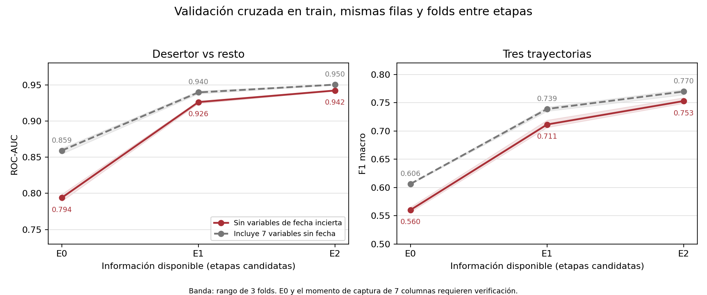

# TP1 alternativo: qué permite predecir cada momento de información

## Resumen

La guía de la cátedra pide comparar modelos de clasificación binaria y
multiclase para predecir deserción con información de inscripción y del
primer año. **No exige usar literalmente las 27 columnas juntas**; esa es
la elección del caso completo de la primera resolución. Como extensión, en la misma base de
50.000 registros del TP original comparamos conjuntos
acumulativos de predictores candidatos al ingreso (E0, 12 columnas), al primer
semestre (E1, 16) y al segundo (E2, 20). Siete columnas administrativas y
familiares sin fecha de captura documentada se estudiaron aparte. El EDA
condicionado por la trayectoria se hizo en train; las etapas compartieron
individuos, folds y una familia de modelo por tarea. En CV, la Logística
binaria pasó de ROC-AUC 0,7941 a 0,9262 y 0,9422; el Árbol multiclase pasó
de F1 macro 0,5603 a 0,7115 y 0,7529. Añadir las siete columnas sin fecha
elevó ambos scores, pero no autoriza a usarlas como señales de ingreso.
La base no contiene fecha individual de abandono y ya fue analizada en el
TP anterior: **la extensión por etapas** es exploratoria y no valida una
alerta previa al abandono ni una inferencia causal. Esas condiciones no
son requisitos de la clasificación con el primer año completo.

## 1. Pregunta y relación con la primera resolución

El TP original responde principalmente **cómo se comparan algoritmos** al
usar las 27 variables. Aquí se pregunta **qué cambia al agregar grupos de
variables asociados a momentos del primer año**, manteniendo un mismo
protocolo y familia de modelo dentro de cada tarea. Los valores absolutos
entre informes no miden efecto de algoritmo: el split binario del TP original
se estratificó con el target binario, y esta alternativa usa un único split
estratificado por tres clases para todas las tareas. La copia del primer
informe y sus vínculos están en `../01_resolucion_original/`.

## 2. Base, auditoría y disponibilidad

Se reconstruyó la base de `00_base_de_datos/dataset_partes/` y se verificó
su identidad byte a byte con el CSV analizado: 11.177.349 bytes, SHA-256
`a0a75e40e32ae336c24fad49fb271da45429593e1fccc16f08c397a1f3bbe09d`.
Contiene 50.000 filas, 27 predictores y target de tres clases; no se
observaron faltantes. El split estratificado por target con semilla 42 deja
40.000 train y 10.000 test. Todas las tablas de EDA condicionado por target
en `eda/resultados/` provienen de **train**.

Separamos tres clases de columnas:

| Grupo | Columnas | Restricción |
|---|---:|---|
| E0 candidatas | 12 | Algunas parecen de inscripción por nombre; falta verificar documentalmente que todas se conocían entonces. |
| Primer semestre | 4 | El nombre sitúa el registro en S1; falta fecha exacta de captura y de abandono. |
| Segundo semestre | 4 | El nombre sitúa el registro en S2; puede reflejar un abandono ya sucedido. |
| Fecha no documentada | 7 | Deuda, matrícula, beca, dos columnas de demanda cognitiva parental y dos de ingresos parentales. |

El inventario original 19+4+4 asignaba a «inscripción/contexto» cualquier
nombre que no incluyera semestre; **esa función no prueba el momento de
medición**. Por eso el escenario que usa los 27 predictores se llama
E2+? y no «predicción desde el ingreso». El listado exacto de columnas
queda en `resultados_modelos/protocolo_ejecutado.json`.

Hay 313 filas completamente idénticas en toda la base y 46/74 casos con
más materias aprobadas que inscriptas en S1/S2. No se borraron sin
identificador y justificación. En la partición usada, 103 casos de test
comparten sus 27 predictores exactamente con alguna fila de train. No
sabemos si representan estudiantes repetidos. Se informa una sensibilidad
excluyendo esas 103 filas al evaluar, sin tratarla como una validación por
identidad personal.

## 3. EDA: qué vimos antes de contrastar las etapas

El EDA extenso, sus denominadores y figuras se documentan en `eda/README.md`
y se generan con `eda/eda_train.py`. Para una lectura básica, empezar por
[`eda/RECORRIDO_EDA.md`](eda/RECORRIDO_EDA.md); el
[`EDA comentado`](eda/EDA_27_VARIABLES_COMENTADO.md) explica qué vemos y qué
habría que verificar en las 27 variables; el
[`atlas/README.md`](eda/atlas/README.md) presenta un gráfico y una
pregunta respondida para cada uno de los 27 predictores.

El apartado **«Qué tipo tiene cada variable y cómo se analiza»** del EDA enumera
los 11 predictores numéricos, los 16 categóricos y el target por separado.
Explica qué distribución, denominador, cruce con target y redundancia mirar
antes de pasar de asociaciones descriptivas a modelos predictivos.

Tres hallazgos ayudan a formular teorías:

1. **Actividad y rendimiento son dos aspectos distintos.** Aprobadas S1
   es cero en 58,15 % de Desertor frente a 4,20 % de En Curso y 1,47 %
   de Graduado. En S2 son 67,90 %, 4,62 % y 1,50 %. Entre los registros
   positivos, las medianas de materias aprobadas siguen separándose:
   S1 = 4/5/6 y S2 = 3/4/6 para Desertor/En Curso/Graduado.
2. **La aprobación observada difiere entre semestres.** En train, entre inscritos con
   aprobadas S1 positivas que pasan a cero en S2 (n=1.545), 92,43 % están
   etiquetados Desertor. Entre quienes pasan de cero a positivo (n=217),
   también 64,06 % son Desertor. La etiqueta final no se deduce de una
   transición aislada y no hay fecha de baja para ordenar los eventos.
3. **Hay asociaciones anteriores o de fecha incierta.** Edad mediana
   22 en Desertor y 19 en las otras clases; carreras con tasas muy
   diferentes; matrícula no al día asociada a 93,79 % de Desertor
   (n=4.332). Las dos parejas demanda cognitiva/ingresos de cada progenitor
   contienen codificaciones categóricas equivalentes en train. No contamos
   cada miembro de la pareja como una fuente independiente de información.

`eda/README.md` desarrolla siete hipótesis exploratorias, sus contrastes
y criterios que las debilitarían. `TEORIAS_DESDE_EDA.md` profundiza cinco
ejes de interpretación y las preguntas que estos datos no pueden resolver.

## 4. Métodos de clasificación y evaluación

Se mantuvieron exactamente los mismos individuos y folds en cada etapa.
La tarea **binaria** fue Desertor=1 frente a Graduado/En Curso=0 y se usó
Logística con `C=[0.01,0.1,1,10]`, `GridSearchCV` de 3 folds estratificados
y ROC-AUC como selección. Se reportan además average precision (AP),
precision, recall, F1, accuracy y matriz de confusión. La tarea **multiclase**
usó Árbol con profundidades `[4,8,12,None]`, hojas mínimas `[10,50]` y
selección por F1 macro; se reportan las métricas por clase y la matriz 3×3.

Imputación, One-Hot y escalado de numéricas para Logística están dentro del
pipeline y se aprenden solo en train de cada fold. Se incluyó un
`DummyClassifier` que predice siempre la clase más frecuente. La CV es la
evidencia central para comparar las etapas; los scores de test se presentan
una vez para los escenarios especificados y se interpretan como
exploratorios porque la base ya tuvo un test examinado en el TP previo.

## 5. Resultados de validación cruzada

**Figura 1.** Score medio de tres folds de train; la banda muestra el rango
de esos tres valores, no un intervalo de confianza. La línea con variables
de fecha incierta es una sensibilidad de disponibilidad, no un modelo
operativo al ingreso.

| Etapa | N columnas | ROC-AUC CV binario | F1 macro CV multiclase |
|---|---:|---:|---:|
| E0: entrada candidata | 12 | 0,7941 | 0,5603 |
| E1: + primer semestre | 16 | 0,9262 | 0,7115 |
| E2: + segundo semestre | 20 | 0,9422 | 0,7529 |
| E0+?: + siete sin fecha | 19 | 0,8592 | 0,6064 |
| E1+?: + siete sin fecha | 23 | 0,9396 | 0,7389 |
| E2+?: + siete sin fecha | 27 | 0,9503 | 0,7698 |

Dentro de la **misma tarea binaria**, E1−E0 = +0,1321 de ROC-AUC y
E2−E1 = +0,0160 en CV. Dentro de la **misma tarea multiclase**, los
incrementos de F1 macro son +0,1512 y +0,0415. Los aumentos de E0+?−E0
son +0,0651 de ROC-AUC y +0,0461 de F1 macro, pero las siete columnas
añadidas no tienen fecha de disponibilidad acreditada. Estos son cambios
del sistema de predictores bajo un protocolo común; no son ganancias
atribuibles a un algoritmo nuevo.

La búsqueda principal reelige un hiperparámetro por etapa. Como sensibilidad,
`modelos/validacion_config_fija.py` mantiene `C=0.1` o Árbol de profundidad 8
y hoja 50 en todos los escenarios **dentro de train**. Sus scores E0→E1→E2
son 0,7941→0,9262→0,9422 (binario) y 0,5491→0,7109→0,7522
(multiclase). La tendencia persiste aunque no se cambie la complejidad
entre etapas. Los folds, configuraciones elegidas y resultados fijos están
en los CSV de `resultados_modelos/`.

## 6. Evaluación descriptiva en test

| Etapa | ROC-AUC binario | AP binaria | Recall Desertor binario | F1 macro multiclase | F1 En Curso |
|---|---:|---:|---:|---:|---:|
| E0 | 0,8025 | 0,6752 | 0,4961 | 0,5643 | 0,3205 |
| E1 | 0,9293 | 0,8899 | 0,7450 | 0,7049 | 0,4733 |
| E2 | 0,9446 | 0,9138 | 0,7843 | 0,7455 | 0,5454 |
| E2+? | 0,9518 | 0,9302 | 0,8113 | 0,7699 | 0,5899 |
| Dummy más frecuente | 0,5000 | 0,3306 | 0 | 0,2144 | 0 |

En test binario, E0 detecta 1.640 de 3.306 Desertor y omite 1.666;
E1 detecta 2.463 y omite 843; E2 detecta 2.593 y omite 713. Estos
números dependen del umbral de clasificación por defecto; ROC-AUC y AP
resumen el ordenamiento de scores bajo sus respectivas definiciones.

En multiclase, En Curso sigue siendo la clase menos precisa de identificar:
su F1 pasa de 0,3205 (E0) a 0,4733 (E1) y 0,5454 (E2). Las matrices
completas y tasas por clase se conservan en `matrices_confusion.csv` y
`metricas_por_clase.csv`.

### Sensibilidad a coincidencias exactas con train

De las 10.000 filas de test, 103 (1,03 %) tienen sus **27 predictores**
idénticos a los de alguna fila de train. En 94 casos al menos una fila de
train con ese mismo perfil comparte el target; en 9 casos no. Sin ID de
estudiante no podemos decidir si son la misma persona, dos trayectorias
con iguales predictores o registros generados artificialmente.

Calculamos las métricas dos veces sobre **las mismas predicciones**: primero
con todo test y luego sin esas 103 filas. El entrenamiento, el split y los
hiperparámetros elegidos por CV en train no cambian.

| Tarea y bloque | Métrica | Test completo (n=10.000) | Sin las 103 coincidencias (n=9.897) | Diferencia |
|---|---|---:|---:|---:|
| Binaria E2, 20 predictores | ROC-AUC | 0,9446 | 0,9440 | −0,0006 |
| Multiclase E2, 20 predictores | F1 macro | 0,7455 | 0,7448 | −0,0007 |
| Binaria E2 + 7 sin fecha, 27 predictores | ROC-AUC | 0,9518 | 0,9513 | −0,0005 |
| Multiclase E2 + 7 sin fecha, 27 predictores | F1 macro | 0,7699 | 0,7694 | −0,0005 |

Fuente: [`metricas.csv`](resultados_modelos/metricas.csv), filas
`test_completo` y `sin_vector_exacto_en_train`. El filtro se define sobre
las **27** columnas incluso para E2 (20): pueden existir más coincidencias
si sólo miramos los campos que usa ese modelo. Los cambios pequeños indican
que quitar estas coincidencias exactas no modifica materialmente **estas**
métricas; no descartan dependencia por perfiles parecidos, ni validan el
modelo en otra cohorte. Además, el test ya había sido observado en una
versión anterior del TP, de modo que este control sigue siendo exploratorio.

## 7. Discusión y alcance de las hipótesis

La señal de actividad y rendimiento del primer año domina la diferencia
entre escenarios de esta base. La mejora de E1 y E2 es coherente con los
ceros y las medianas del EDA, pero el experimento agrega cuatro columnas
por vez: no atribuye cada aumento únicamente a materias aprobadas, ni
aisla el indicador de cero del nivel entre positivos. La asociación con
estado de matrícula es fuerte y añade capacidad predictiva al permitir
las siete columnas sin fecha; falta comprobar **cuándo** se registraron.

La expresión «alerta temprana» requeriría fecha de captura para cada
predictor y fecha del abandono, además de una muestra externa. Incluso
E0 contiene variables de ingreso candidatas cuya disponibilidad debe
confirmarse. El conjunto final está sintéticamente aumentado y transformado;
una partición aleatoria única, valores repetidos y un test ya examinado
limitan el alcance de la generalización. En Curso es un estado abierto y
la caída de su error no prueba que su destino final se conozca.

## Conclusión

En esta base, un mismo protocolo de clasificación mejora claramente al
incorporar el primer semestre y mejora menos al añadir el segundo. La
lectura de esta extensión es sobre **información registrada en distintos
momentos**. La resolución principal ya clasifica con el primer año completo;
no exige demostrar eficacia prospectiva de una intervención. Las columnas
sin fecha pueden elevar la predicción, pero no deben incluirse en un modelo
específico **de ingreso** sin verificar su momento de captura.
