# Atlas de las 27 variables: preguntas, respuestas y gráficos

Para una lectura guiada y preguntas por cada variable, ver el [EDA comentado](../EDA_27_VARIABLES_COMENTADO.md).

**Base:** 40.000 observaciones de train. Test reservado: 10.000. Fuente SHA-256 `a0a75e40e32ae336c24fad49fb271da45429593e1fccc16f08c397a1f3bbe09d`.

Este atlas se genera con `atlas_variables.py` usando el mismo split estratificado que `eda_train.py` (20 % test, semilla 42). Ningún gráfico usa el target de test. Los números son asociaciones descriptivas exploratorias de esta base, no efectos causales.

## Cómo leer cada figura

- **Numérica:** izquierda = distribución total de train; derecha = mediana (punto) y 25.º–75.º percentil por clase. En las ocho académicas, el panel derecho muestra sólo valores positivos y el texto informa por separado el porcentaje de ceros.
- **Categórica:** izquierda = número de estudiantes por nivel; derecha = porcentaje Desertor dentro de ese nivel. La línea gris marca el 33,1 % global de train; el rojo destaca niveles por encima con n≥100. No confundir P(Desertor | nivel) con P(nivel | Desertor).
- `n` es el denominador de cada categoría. Para todas las tasas y los intervalos de Wilson por nivel, ver `../resultados/04_categoricas_por_clase_train.csv`. Para medianas y `n_positivos`, ver `../resultados/03_numericas_por_clase_train.csv`.

## Antes de interpretar: ¿qué contiene la base?

El target distingue **Desertor (13.223; 33,1 %), En Curso (7.811; 19,5 %) y Graduado (18.966; 47,4 %)**. Hay 11 variables numéricas, 16 categóricas y ningún `NaN` codificado como faltante. Una nota cero puede tener un significado institucional distinto de una evaluación rendida con nota cero. [Ver gráfico de clases](../resultados/01_clases_train.png).

## Numéricas de estudios previos e ingreso (3)

### 01. Nota de estudios previos

**Columna:** `Cualificación_promedio_de_estudios_previos` · **Tipo:** numérica · **Momento:** `ingreso_sugerido_por_nombre_o_diccionario`.

**Pregunta básica:** ¿Qué valores toma y se solapan entre Desertor, En Curso y Graduado?

**Respuesta con train:** Valores: 48–95; **medianas por clase:** Desertor 67, En Curso 65, Graduado 67. La mediana sola no mide capacidad predictiva; observar solapamiento de distribuciones y tamaños.

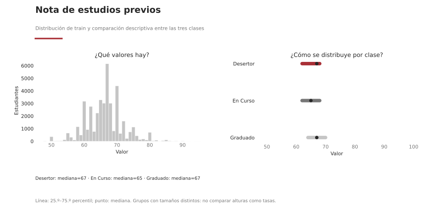

### 02. Puntaje de ingreso

**Columna:** `Puntaje_en_examen_de_ingreso` · **Tipo:** numérica · **Momento:** `ingreso_sugerido_por_nombre_o_diccionario`.

**Pregunta básica:** ¿Qué valores toma y se solapan entre Desertor, En Curso y Graduado?

**Respuesta con train:** Valores: 48–95; **medianas por clase:** Desertor 61, En Curso 61, Graduado 63. La mediana sola no mide capacidad predictiva; observar solapamiento de distribuciones y tamaños.

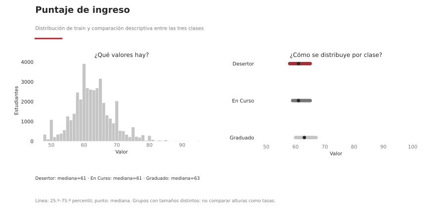

### 03. Edad al inscribirse

**Columna:** `Edad_al_momento_de_la_inscripción` · **Tipo:** numérica · **Momento:** `ingreso_sugerido_por_nombre_o_diccionario`.

**Pregunta básica:** ¿Qué valores toma y se solapan entre Desertor, En Curso y Graduado?

**Respuesta con train:** Valores: 17–70; **medianas por clase:** Desertor 22, En Curso 19, Graduado 19. La mediana sola no mide capacidad predictiva; observar solapamiento de distribuciones y tamaños.

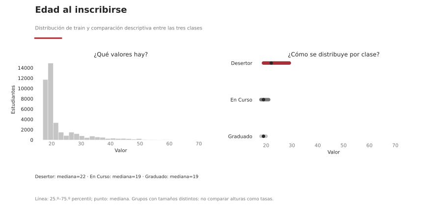

## Numéricas del primer semestre (4)

### 04. Materias inscriptas · 1.er semestre

**Columna:** `Unidades_curriculares_1er_semestre_(inscrito)` · **Tipo:** numérica · **Momento:** `cierre_1er_semestre_inferido`.

**Pregunta básica:** ¿Qué valores toma, cuántos ceros hay y cómo se distribuyen en cada clase?

**Respuesta con train:** Valores: 0–26; cero en 1.382/40.000 observaciones. **Ceros dentro de cada clase:** Desertor 7.8%, En Curso 1.1%, Graduado 1.3%. **Mediana entre valores positivos:** Desertor 6, En Curso 6, Graduado 6. Comparar también el número de observaciones positivas en la tabla, y verificar si cero significa falta de aprobación, evaluación o cursada.

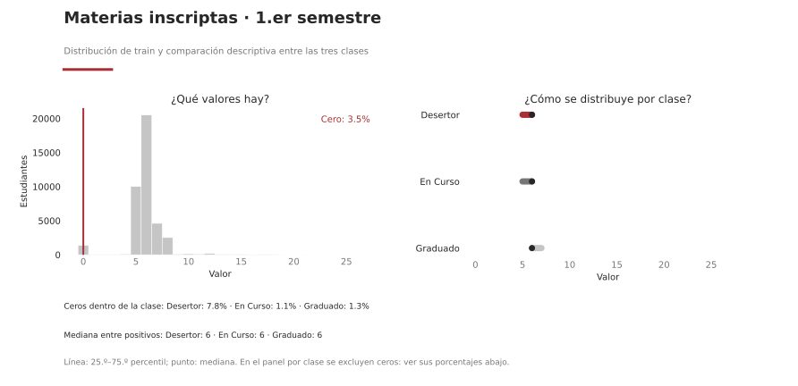

### 05. Evaluaciones · 1.er semestre

**Columna:** `Cantidad_de_evaluaciones_en_el_1er_semestre` · **Tipo:** numérica · **Momento:** `cierre_1er_semestre_inferido`.

**Pregunta básica:** ¿Qué valores toma, cuántos ceros hay y cómo se distribuyen en cada clase?

**Respuesta con train:** Valores: 0–45; cero en 4.079/40.000 observaciones. **Ceros dentro de cada clase:** Desertor 27.9%, En Curso 1.5%, Graduado 1.4%. **Mediana entre valores positivos:** Desertor 8, En Curso 9, Graduado 7. Comparar también el número de observaciones positivas en la tabla, y verificar si cero significa falta de aprobación, evaluación o cursada.

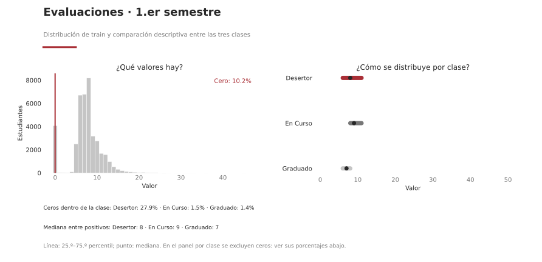

### 06. Materias aprobadas · 1.er semestre

**Columna:** `Unidades_curriculares_1er_semestre_(aprobadas)` · **Tipo:** numérica · **Momento:** `cierre_1er_semestre_inferido`.

**Pregunta básica:** ¿Qué valores toma, cuántos ceros hay y cómo se distribuyen en cada clase?

**Respuesta con train:** Valores: 0–26; cero en 8.296/40.000 observaciones. **Ceros dentro de cada clase:** Desertor 58.1%, En Curso 4.2%, Graduado 1.5%. **Mediana entre valores positivos:** Desertor 4, En Curso 5, Graduado 6. Comparar también el número de observaciones positivas en la tabla, y verificar si cero significa falta de aprobación, evaluación o cursada.

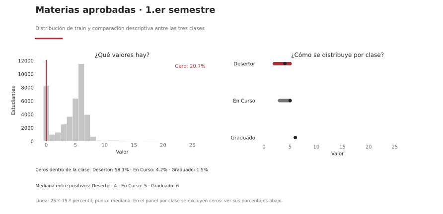

### 07. Nota promedio · 1.er semestre

**Columna:** `Nota_promedio_en_el_1er_semestre` · **Tipo:** numérica · **Momento:** `cierre_1er_semestre_inferido`.

**Pregunta básica:** ¿Qué valores toma, cuántos ceros hay y cómo se distribuyen en cada clase?

**Respuesta con train:** Valores: 0–90; cero en 8.298/40.000 observaciones. **Ceros dentro de cada clase:** Desertor 58.1%, En Curso 4.2%, Graduado 1.5%. **Mediana entre valores positivos:** Desertor 59, En Curso 60, Graduado 66. Comparar también el número de observaciones positivas en la tabla, y verificar si cero significa falta de aprobación, evaluación o cursada.

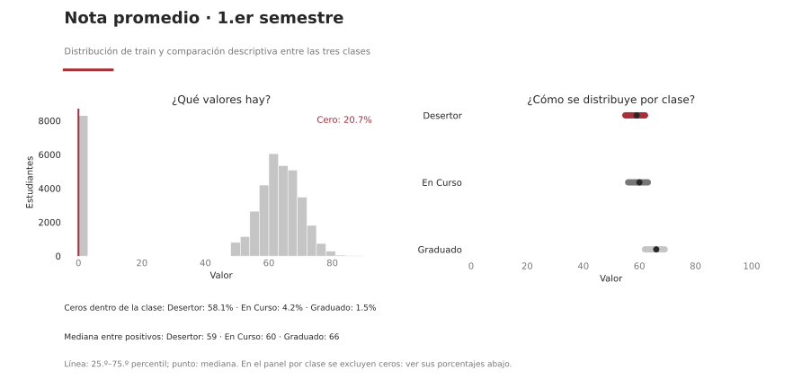

## Numéricas del segundo semestre (4)

### 08. Materias inscriptas · 2.º semestre

**Columna:** `Unidades_curriculares_2do_semestre_(inscrito)` · **Tipo:** numérica · **Momento:** `cierre_2do_semestre_inferido`.

**Pregunta básica:** ¿Qué valores toma, cuántos ceros hay y cómo se distribuyen en cada clase?

**Respuesta con train:** Valores: 0–21; cero en 1.383/40.000 observaciones. **Ceros dentro de cada clase:** Desertor 7.9%, En Curso 1.1%, Graduado 1.3%. **Mediana entre valores positivos:** Desertor 6, En Curso 6, Graduado 6. Comparar también el número de observaciones positivas en la tabla, y verificar si cero significa falta de aprobación, evaluación o cursada.

### 09. Evaluaciones · 2.º semestre

**Columna:** `Cantidad_de_evaluaciones_en_el_2do_semestre_` · **Tipo:** numérica · **Momento:** `cierre_2do_semestre_inferido`.

**Pregunta básica:** ¿Qué valores toma, cuántos ceros hay y cómo se distribuyen en cada clase?

**Respuesta con train:** Valores: 0–33; cero en 4.534/40.000 observaciones. **Ceros dentro de cada clase:** Desertor 31.3%, En Curso 1.6%, Graduado 1.4%. **Mediana entre valores positivos:** Desertor 8, En Curso 9, Graduado 7. Comparar también el número de observaciones positivas en la tabla, y verificar si cero significa falta de aprobación, evaluación o cursada.

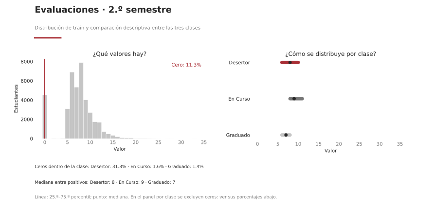

### 10. Materias aprobadas · 2.º semestre

**Columna:** `Unidades_curriculares_2do_semestre_(aprobadas)` · **Tipo:** numérica · **Momento:** `cierre_2do_semestre_inferido`.

**Pregunta básica:** ¿Qué valores toma, cuántos ceros hay y cómo se distribuyen en cada clase?

**Respuesta con train:** Valores: 0–19; cero en 9.623/40.000 observaciones. **Ceros dentro de cada clase:** Desertor 67.9%, En Curso 4.6%, Graduado 1.5%. **Mediana entre valores positivos:** Desertor 3, En Curso 4, Graduado 6. Comparar también el número de observaciones positivas en la tabla, y verificar si cero significa falta de aprobación, evaluación o cursada.

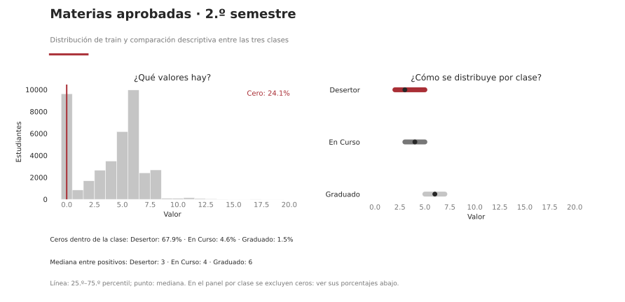

### 11. Nota promedio · 2.º semestre

**Columna:** `Nota_promedio_en_el_2do_semestre` · **Tipo:** numérica · **Momento:** `cierre_2do_semestre_inferido`.

**Pregunta básica:** ¿Qué valores toma, cuántos ceros hay y cómo se distribuyen en cada clase?

**Respuesta con train:** Valores: 0–89; cero en 9.627/40.000 observaciones. **Ceros dentro de cada clase:** Desertor 67.9%, En Curso 4.6%, Graduado 1.5%. **Mediana entre valores positivos:** Desertor 58, En Curso 60, Graduado 66. Comparar también el número de observaciones positivas en la tabla, y verificar si cero significa falta de aprobación, evaluación o cursada.

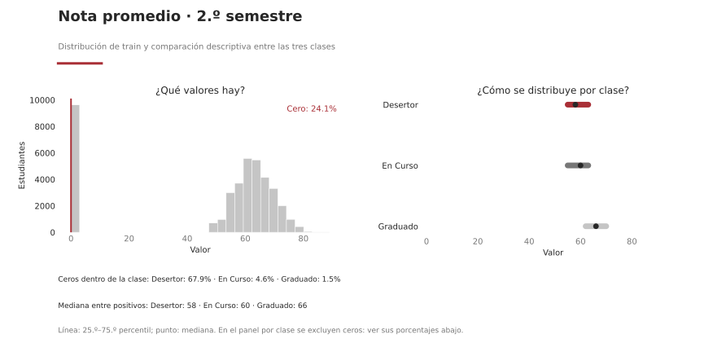

## Categóricas de contexto (9)

### 12. Estudios anteriores

**Columna:** `Estudios_máximos_antes_de_la_inscripción` · **Tipo:** categórica · **Momento:** `ingreso_sugerido_por_nombre_o_diccionario`.

**Pregunta básica:** ¿Cuántos estudiantes hay en cada nivel y qué tasa Desertor tiene cada uno?

**Respuesta con train:** **5 categorías.** La más frecuente es «Educación Secundaria» (n=35.109). Entre categorías con n≥100, la tasa Desertor va de 29.5% en «Educación Secundaria» (n=35.109) a 77.4% en «Educación Básica» (n=2.186). **2 categoría(s) con menos de 100 casos:** no ordenarlas como si la tasa fuese exacta. Son asociaciones descriptivas, sin ajuste por otras variables.

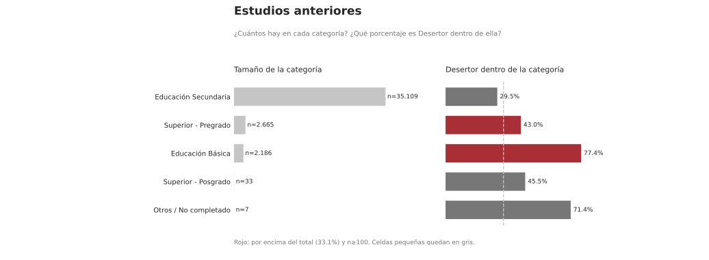

### 13. Estado civil al inscribirse

**Columna:** `estado_civil` · **Tipo:** categórica · **Momento:** `ingreso_sugerido_por_nombre_o_diccionario`.

**Pregunta básica:** ¿Cuántos estudiantes hay en cada nivel y qué tasa Desertor tiene cada uno?

**Respuesta con train:** **6 categorías.** La más frecuente es «Soltero» (n=36.712). Entre categorías con n≥100, la tasa Desertor va de 30.9% en «Soltero» (n=36.712) a 61.8% en «Divorciado» (n=471). **3 categoría(s) con menos de 100 casos:** no ordenarlas como si la tasa fuese exacta. Son asociaciones descriptivas, sin ajuste por otras variables.

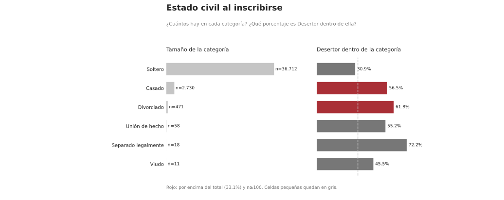

### 14. Modo de ingreso

**Columna:** `modo_aplicacion` · **Tipo:** categórica · **Momento:** `ingreso_sugerido_por_nombre_o_diccionario`.

**Pregunta básica:** ¿Cuántos estudiantes hay en cada nivel y qué tasa Desertor tiene cada uno?

**Respuesta con train:** **4 categorías.** La más frecuente es «Acceso General» (n=27.723). Entre categorías con n≥100, la tasa Desertor va de 13.7% en «Contingente Especial (Regional)» (n=183) a 72.1% en «Acceso para Titulados» (n=799). Son asociaciones descriptivas, sin ajuste por otras variables.

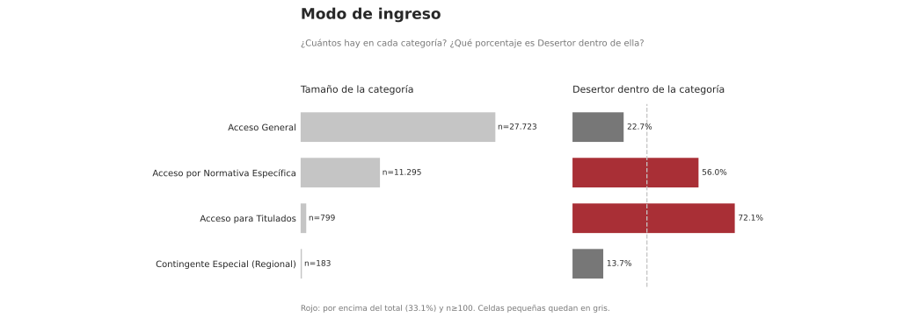

### 15. Sexo registrado

**Columna:** `sexo` · **Tipo:** categórica · **Momento:** `ingreso_candidato_fecha_por_confirmar`.

**Pregunta básica:** ¿Cuántos estudiantes hay en cada nivel y qué tasa Desertor tiene cada uno?

**Respuesta con train:** **2 categorías.** La más frecuente es «Femenino» (n=27.392). Entre categorías con n≥100, la tasa Desertor va de 23.7% en «Femenino» (n=27.392) a 53.4% en «Masculino» (n=12.608). Son asociaciones descriptivas, sin ajuste por otras variables.

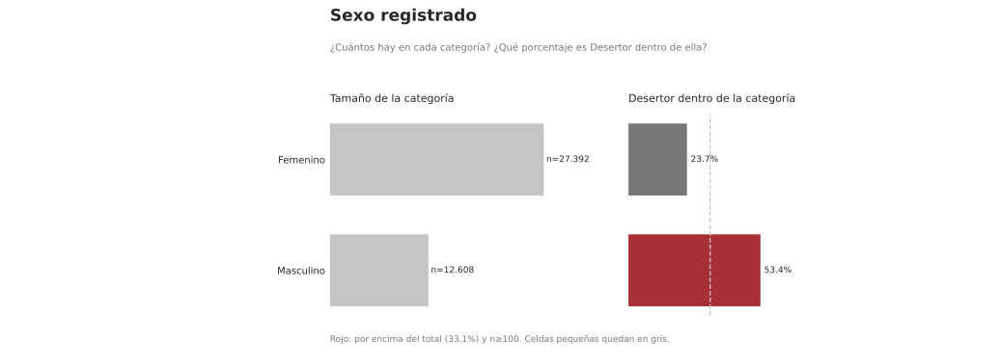

### 16. Desplazamiento de localidad

**Columna:** `desplazado` · **Tipo:** categórica · **Momento:** `ingreso_candidato_fecha_por_confirmar`.

**Pregunta básica:** ¿Cuántos estudiantes hay en cada nivel y qué tasa Desertor tiene cada uno?

**Respuesta con train:** **2 categorías.** La más frecuente es «Sí» (n=22.891). Entre categorías con n≥100, la tasa Desertor va de 27.3% en «Sí» (n=22.891) a 40.8% en «No» (n=17.109). Son asociaciones descriptivas, sin ajuste por otras variables.

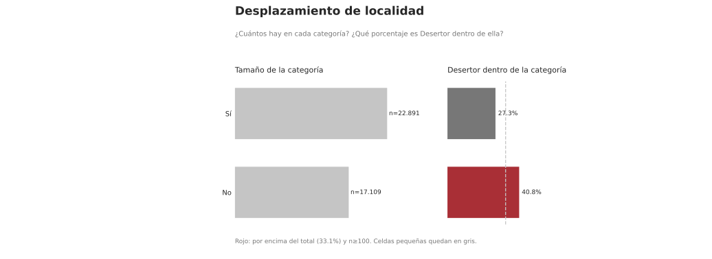

### 17. Carrera

**Columna:** `Carrera` · **Tipo:** categórica · **Momento:** `ingreso_sugerido_por_nombre_o_diccionario`.

**Pregunta básica:** ¿Cuántos estudiantes hay en cada nivel y qué tasa Desertor tiene cada uno?

**Respuesta con train:** **15 categorías.** La más frecuente es «Enfermería» (n=6.297). Entre categorías con n≥100, la tasa Desertor va de 13.6% en «Enfermería» (n=6.297) a 71.3% en «Animación y Diseño Multimedia» (n=1.474). **1 categoría(s) con menos de 100 casos:** no ordenarlas como si la tasa fuese exacta. Son asociaciones descriptivas, sin ajuste por otras variables.

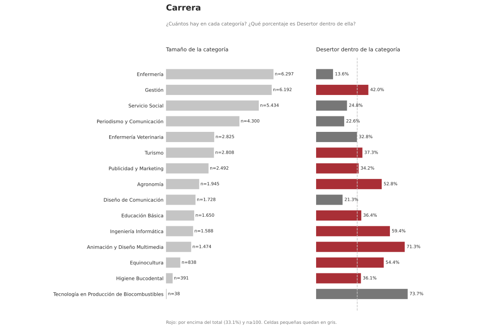

### 18. Turno

**Columna:** `Asistencia_diurna/nocturna` · **Tipo:** categórica · **Momento:** `ingreso_candidato_fecha_por_confirmar`.

**Pregunta básica:** ¿Cuántos estudiantes hay en cada nivel y qué tasa Desertor tiene cada uno?

**Respuesta con train:** **2 categorías.** La más frecuente es «Diurna» (n=36.633). Entre categorías con n≥100, la tasa Desertor va de 31.2% en «Diurna» (n=36.633) a 52.9% en «Nocturna» (n=3.367). Son asociaciones descriptivas, sin ajuste por otras variables.

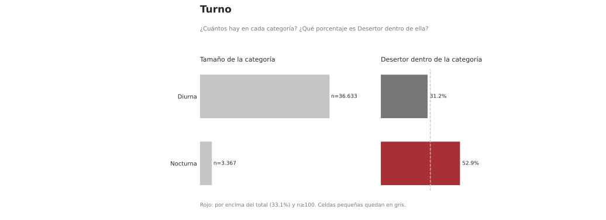

### 19. Necesidades educativas declaradas

**Columna:** `Necesidades_educativas_especiales` · **Tipo:** categórica · **Momento:** `ingreso_candidato_fecha_por_confirmar`.

**Pregunta básica:** ¿Cuántos estudiantes hay en cada nivel y qué tasa Desertor tiene cada uno?

**Respuesta con train:** **2 categorías.** La más frecuente es «No» (n=39.842). Entre categorías con n≥100, la tasa Desertor va de 33.1% en «No» (n=39.842) a 33.5% en «Sí» (n=158). Son asociaciones descriptivas, sin ajuste por otras variables.

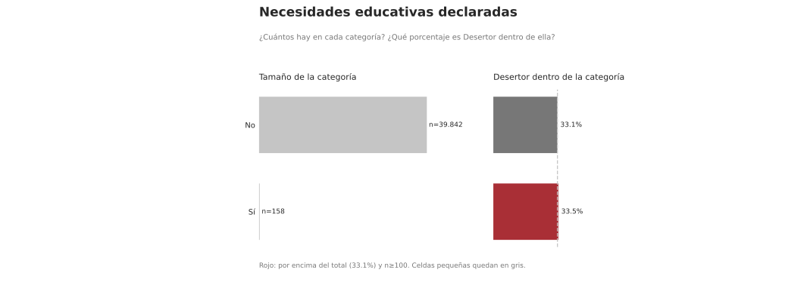

### 20. Estudiante internacional

**Columna:** `Estudiante_Internacional` · **Tipo:** categórica · **Momento:** `ingreso_candidato_fecha_por_confirmar`.

**Pregunta básica:** ¿Cuántos estudiantes hay en cada nivel y qué tasa Desertor tiene cada uno?

**Respuesta con train:** **2 categorías.** La más frecuente es «No» (n=39.743). Entre categorías con n≥100, la tasa Desertor va de 32.3% en «Sí» (n=257) a 33.1% en «No» (n=39.743). Son asociaciones descriptivas, sin ajuste por otras variables.

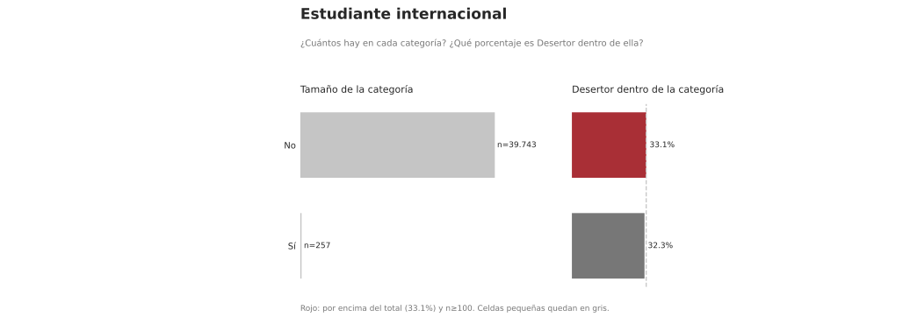

## Categóricas administrativas (3)

### 21. Deuda con la institución

**Columna:** `Tiene_deuda` · **Tipo:** categórica · **Momento:** `fecha_de_captura_por_verificar`.

**Pregunta básica:** ¿Cuántos estudiantes hay en cada nivel y qué tasa Desertor tiene cada uno?

**Respuesta con train:** **2 categorías.** La más frecuente es «No» (n=37.123). Entre categorías con n≥100, la tasa Desertor va de 29.7% en «No» (n=37.123) a 76.1% en «Sí» (n=2.877). Son asociaciones descriptivas, sin ajuste por otras variables.

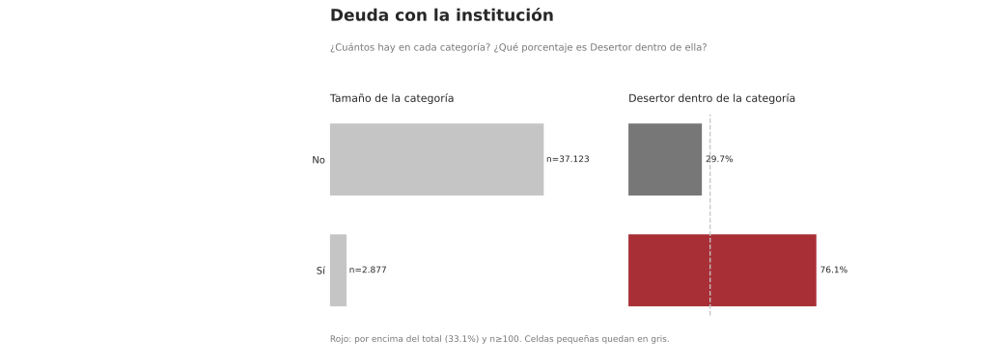

### 22. Matrícula al día

**Columna:** `Pago_de_matrícula_al_día` · **Tipo:** categórica · **Momento:** `fecha_de_captura_por_verificar`.

**Pregunta básica:** ¿Cuántos estudiantes hay en cada nivel y qué tasa Desertor tiene cada uno?

**Respuesta con train:** **2 categorías.** La más frecuente es «Sí» (n=35.668). Entre categorías con n≥100, la tasa Desertor va de 25.7% en «Sí» (n=35.668) a 93.8% en «No» (n=4.332). Son asociaciones descriptivas, sin ajuste por otras variables.

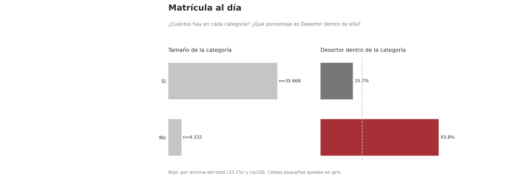

### 23. Beca

**Columna:** `Poseedor_de_Beca` · **Tipo:** categórica · **Momento:** `fecha_de_captura_por_verificar`.

**Pregunta básica:** ¿Cuántos estudiantes hay en cada nivel y qué tasa Desertor tiene cada uno?

**Respuesta con train:** **2 categorías.** La más frecuente es «No» (n=30.070). Entre categorías con n≥100, la tasa Desertor va de 7.2% en «Sí» (n=9.930) a 41.6% en «No» (n=30.070). Son asociaciones descriptivas, sin ajuste por otras variables.

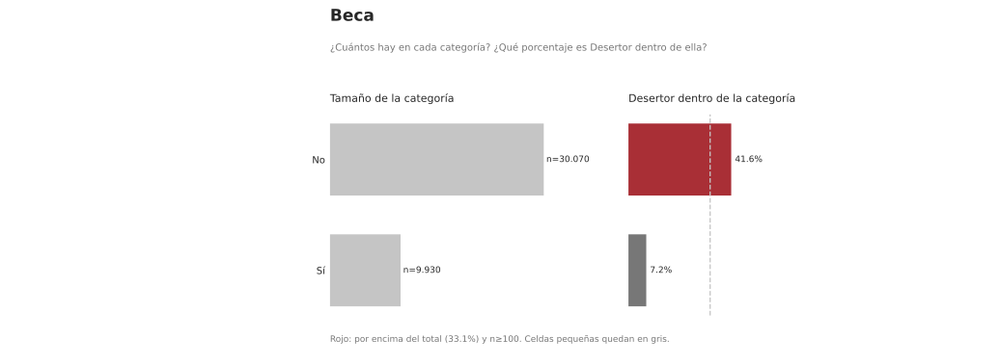

## Categóricas ordinales familiares (4)

### 24. Demanda cognitiva de ocupación · padre

**Columna:** `Demanda_Cog_Padre` · **Tipo:** categórica ordinal · **Momento:** `fecha_de_captura_por_verificar`.

**Pregunta básica:** ¿Cuántos estudiantes hay en cada nivel y qué tasa Desertor tiene cada uno?

**Respuesta con train:** **5 categorías.** La más frecuente es «Muy baja demanda cognitiva» (n=15.987). Entre categorías con n≥100, la tasa Desertor va de 27.4% en «Demanda cognitiva baja» (n=8.247) a 36.9% en «Muy baja demanda cognitiva» (n=15.987). Son asociaciones descriptivas, sin ajuste por otras variables.

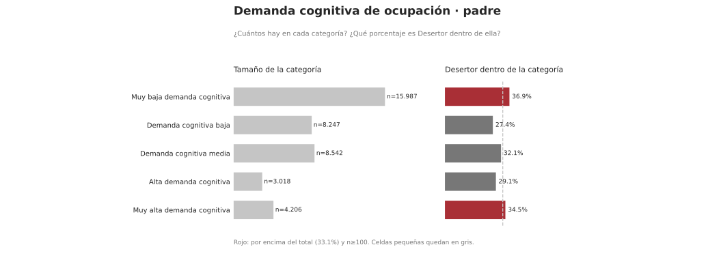

### 25. Demanda cognitiva de ocupación · madre

**Columna:** `Demanda_Cog_Madre` · **Tipo:** categórica ordinal · **Momento:** `fecha_de_captura_por_verificar`.

**Pregunta básica:** ¿Cuántos estudiantes hay en cada nivel y qué tasa Desertor tiene cada uno?

**Respuesta con train:** **5 categorías.** La más frecuente es «Muy baja demanda cognitiva» (n=18.694). Entre categorías con n≥100, la tasa Desertor va de 24.0% en «Alta demanda cognitiva» (n=2.443) a 37.3% en «Muy baja demanda cognitiva» (n=18.694). Son asociaciones descriptivas, sin ajuste por otras variables.

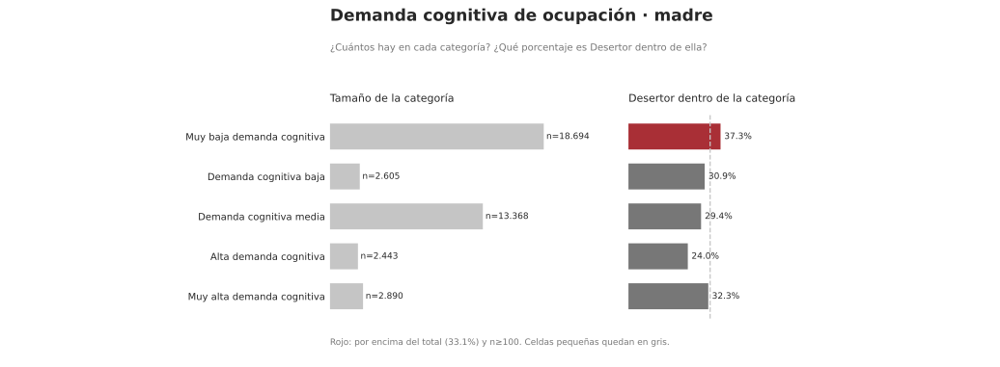

### 26. Nivel de ingreso estimado · padre

**Columna:** `Ingresos_Padre` · **Tipo:** categórica ordinal · **Momento:** `fecha_de_captura_por_verificar`.

**Pregunta básica:** ¿Cuántos estudiantes hay en cada nivel y qué tasa Desertor tiene cada uno?

**Respuesta con train:** **5 categorías.** La más frecuente es «Bajos ingresos» (n=15.987). Entre categorías con n≥100, la tasa Desertor va de 27.4% en «Ingresos medios-bajos» (n=8.247) a 36.9% en «Bajos ingresos» (n=15.987). Son asociaciones descriptivas, sin ajuste por otras variables.

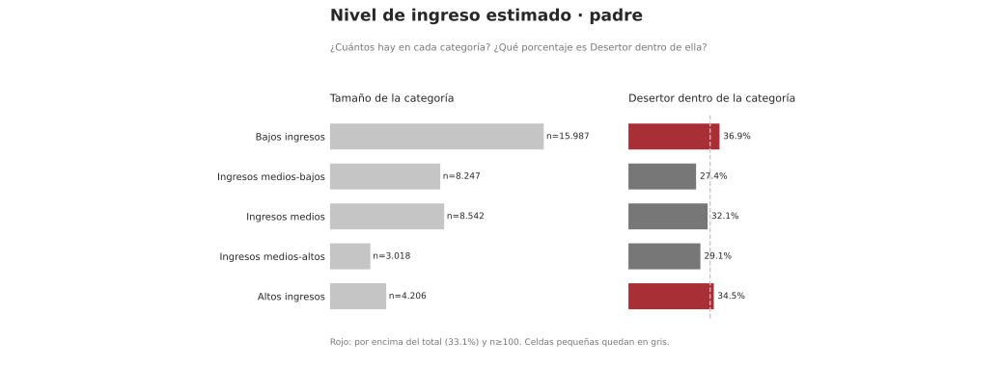

### 27. Nivel de ingreso estimado · madre

**Columna:** `Ingresos_Madre` · **Tipo:** categórica ordinal · **Momento:** `fecha_de_captura_por_verificar`.

**Pregunta básica:** ¿Cuántos estudiantes hay en cada nivel y qué tasa Desertor tiene cada uno?

**Respuesta con train:** **5 categorías.** La más frecuente es «Bajos ingresos» (n=18.694). Entre categorías con n≥100, la tasa Desertor va de 24.0% en «Ingresos medios-altos» (n=2.443) a 37.3% en «Bajos ingresos» (n=18.694). Son asociaciones descriptivas, sin ajuste por otras variables.

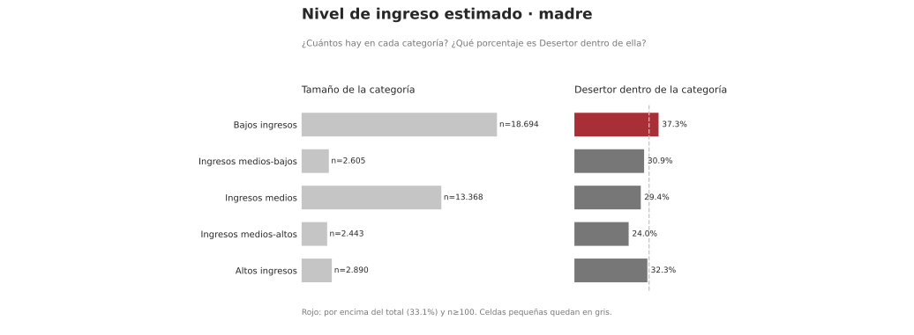

## ¿Cómo paso de estos cruces a variables para el modelo?

1. **Revisar validez y momento:** confirmar significado de cero, fecha de captura y frecuencia de categorías. Una columna muy asociada con target puede ser tardía.
2. **Formular candidatas por EDA:** comparar tasas y distribuciones con `n` suficiente; consultar las tablas completas antes de fijarse sólo en diferencias llamativas. `../resultados/05_asociaciones_marginales_train.csv` resume η² numérica y V de Cramér categórica: **no comparar esas dos escalas entre sí**.
3. **Controlar redundancia y composición:** consultar `../resultados/06_redundancia_train.csv` y tasas estratificadas. Una diferencia simple puede desaparecer al considerar carrera u otras columnas.
4. **Elegir la pregunta de modelado:** usar **27 predictores juntos** para la comparación general del TP, o comparar conjuntos **12 candidatas al ingreso → +4 de S1 → +4 de S2**, y evaluar las **7 sin fecha** en sensibilidad. Esos grupos proceden del significado/fecha sugerida de las columnas, **no de un ranking elegido por el target**.
5. **Medir aporte conjunto:** comparar score de validación con las mismas filas, folds, familia de modelo y preprocesamiento. Una asociación bivariada no asegura mejora en presencia de otras variables. Reservar test; este conjunto ya se vio en el TP previo, por lo que las comparaciones son exploratorias y necesitan otra cohorte para confirmación externa.

**Límite temporal:** no se dispone de fecha individual de abandono ni de medición verificada para las siete variables apartadas. Incorporar S1 o S2 mide información adicional de esas columnas en la base, pero no prueba detección anterior a la deserción.
