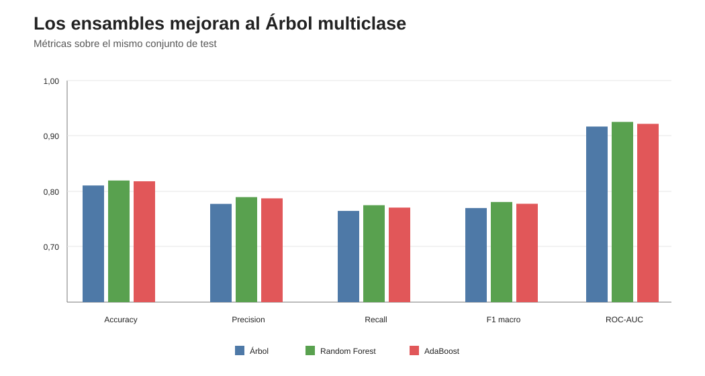
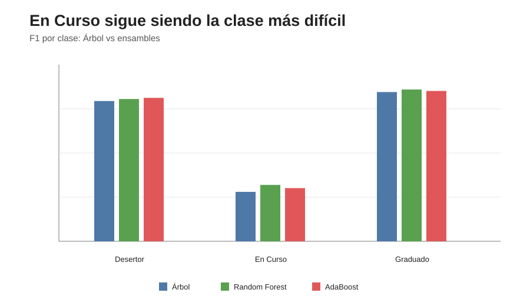

# Informe — Bagging y Boosting

## 1. Objetivo

Se compararon dos ensambles basados en árboles en la tarea multiclase:

- Random Forest;
- AdaBoost.

Ambos se ajustaron mediante GridSearchCV usando F1 macro como criterio y el mismo split del bloque 06.

---

## 2. Resultados globales

| Modelo | Accuracy | Precision macro | Recall macro | F1 macro | ROC-AUC macro OvR |
|---|---:|---:|---:|---:|---:|
| Árbol | 0,8106 | 0,7774 | 0,7647 | 0,7699 | 0,9170 |
| Random Forest | **0,8196** | **0,7896** | **0,7750** | **0,7808** | **0,9254** |
| AdaBoost | 0,8182 | 0,7874 | 0,7707 | 0,7776 | 0,9219 |

Los dos ensambles superan al Árbol individual en todas las métricas globales.

Random Forest obtiene el mejor valor global en accuracy, precision macro, recall macro, F1 macro y ROC-AUC macro OvR.

---

## 3. Random Forest

Configuración seleccionada:

    n_estimators = 500
    max_depth = None
    min_samples_leaf = 1
    max_features = "sqrt"

Resultados por clase:

| Clase | Precision | Recall | F1 |
|---|---:|---:|---:|
| Desertor | 0,9036 | 0,8076 | 0,8529 |
| En Curso | 0,6216 | 0,5981 | 0,6096 |
| Graduado | 0,8436 | 0,9192 | 0,8798 |

Random Forest presenta el mejor balance global y mejora especialmente el desempeño de En Curso respecto del Árbol.

---

## 4. AdaBoost

Configuración seleccionada:

    estimator max_depth = 2
    n_estimators = 400
    learning_rate = 0,1

Resultados por clase:

| Clase | Precision | Recall | F1 |
|---|---:|---:|---:|
| Desertor | 0,8943 | 0,8212 | 0,8562 |
| En Curso | 0,6293 | 0,5745 | 0,6006 |
| Graduado | 0,8386 | 0,9165 | 0,8758 |

AdaBoost obtiene el mejor F1 de Desertor entre los tres modelos comparados, debido principalmente a un recall algo mayor.

---

## 5. La clase En Curso sigue siendo el principal desafío

Los ensambles mejoran En Curso respecto del Árbol, pero continúa siendo la clase con menor F1:

- Árbol: 0,5899;
- AdaBoost: 0,6006;
- Random Forest: 0,6096.

Esto refuerza la conclusión del bloque 06: En Curso presenta una estructura intermedia y difícil de separar.

---

## 6. ¿Qué aporta Bagging?

Random Forest mejora F1 macro de:

    0,7699 → 0,7808

y ROC-AUC macro OvR de:

    0,9170 → 0,9254

La mejora es consistente con la función del bagging: reducir la varianza mediante la combinación de múltiples árboles.

El hecho de que los árboles individuales del bosque puedan crecer sin límite no debe interpretarse igual que un Árbol único sin regularización, porque el promedio del ensamble modifica su comportamiento.

---

## 7. ¿Qué aporta Boosting?

AdaBoost mejora F1 macro de:

    0,7699 → 0,7776

y ROC-AUC macro OvR de:

    0,9170 → 0,9219

El modelo concentra sucesivamente atención en observaciones mal clasificadas y obtiene el mayor recall de Desertor de los tres modelos:

    0,8212

Esto se traduce en el mejor F1 de Desertor (0,8562).

---

## 8. Estabilidad de generalización

Random Forest:

    CV F1 macro = 0,7814
    Test F1 macro = 0,7808

AdaBoost:

    CV F1 macro = 0,7715
    Test F1 macro = 0,7776

Las diferencias son pequeñas y no muestran una caída importante al pasar a test.

---

## 9. Costo computacional

| Modelo | Tiempo GridSearch |
|---|---:|
| Random Forest | 0,74 min |
| AdaBoost | 2,38 min |

AdaBoost fue considerablemente más costoso sin superar a Random Forest en las métricas globales.

---

## 10. Conclusión

Los ensambles mejoran moderadamente al Árbol de Decisión individual.

**Random Forest presenta el mejor desempeño global de la etapa multiclase**, mientras que AdaBoost logra una ligera ventaja específica en la detección de Desertor.

La mejora confirma que combinar múltiples árboles puede reducir errores que persisten en un único árbol, aunque En Curso continúa siendo la clase más difícil.

**Bloque 07 cerrado.**

El siguiente paso es analizar la **importancia de atributos** y contrastarla con las hipótesis formuladas a partir del EDA.
