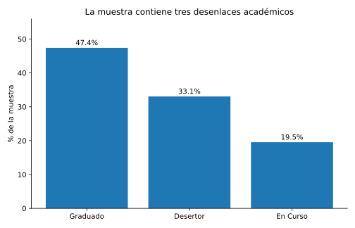
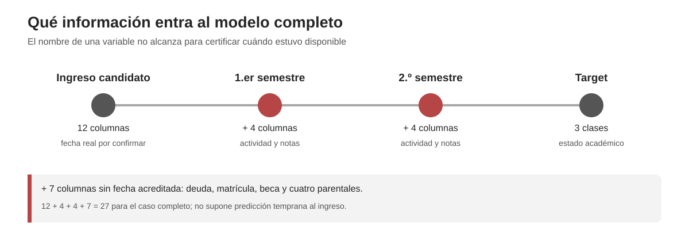
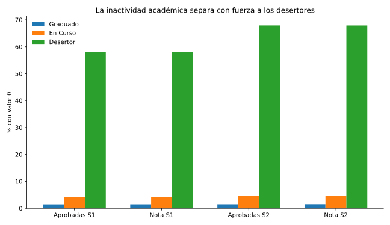
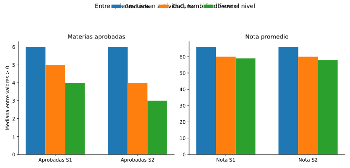
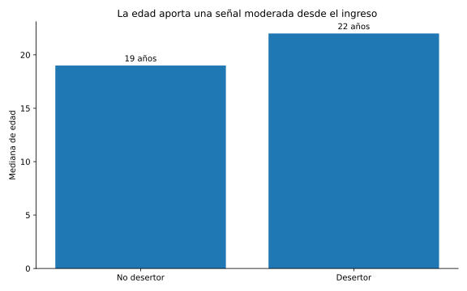
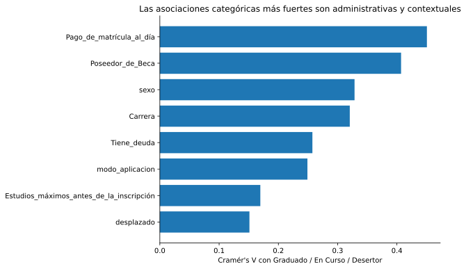
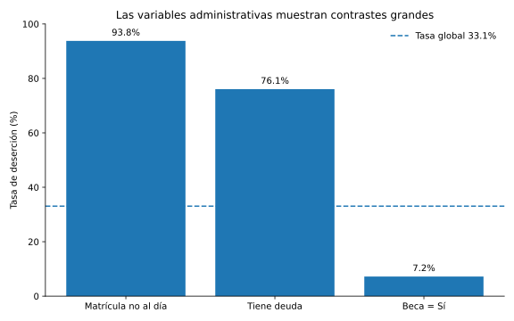
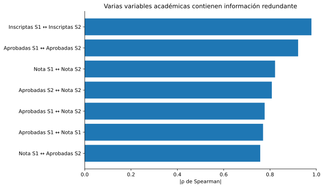

# Informe EDA — Deserción estudiantil

## 1. Propósito y procedencia de los datos

Este EDA se **recalculó sólo sobre las 40.000 filas de train** después de reservar 10.000 de test mediante una partición estratificada por las tres clases con semilla 42. Su objetivo es entender la base, describir las diferencias entre clases y formular hipótesis sin mirar el test. La [alternativa](../../AA%20privada/02_alternativa_temporal/eda/README.md) utiliza exactamente esas mismas filas de train. Una versión anterior había explorado la base completa: aunque aquí se corrigieron las cifras y figuras, ese test ya observado no equivale a una validación independiente nueva.

La base del TP se construyó a partir del archivo `train.csv` de la competencia **Kaggle Playground Series S4E6**, una versión sintéticamente aumentada del dataset original de UCI **“Predict students' dropout and academic success”**. Para adaptarla al trabajo de la cátedra se tradujeron y renombraron variables, se agruparon algunas categorías mediante criterios documentados, se reescalaron las notas y se realizó un submuestreo estratificado a 50.000 casos para mantener las proporciones por carrera y resultado académico. El procedimiento de generación es reproducible mediante una semilla fija.

La base disponible contiene **50.000 registros**, de los cuales **40.000 integran este EDA de train**. Tiene 27 predictores y tres clases: Graduado, Desertor y En Curso. En train no se observaron valores faltantes. Se detectaron 213 filas idénticas y un número pequeño de inconsistencias entre unidades inscriptas y aprobadas; estas observaciones se documentan pero no se corrigen automáticamente porque la base no dispone de un identificador individual que permita determinar su origen.

**Figura 1. Distribución del desenlace académico.** En train, Graduado representa 47,42% (18.966), Desertor 33,06% (13.223) y En Curso 19,53% (7.811). Explorar primero las tres clases por separado evita asumir que Graduado y En Curso constituyen un único perfil.

### Balance de clases y estrategia analítica

Para la tarea binaria, Desertor representa 33,06% de train. El desbalance no es extremo, por lo que la estrategia inicial será **mantener la distribución mediante particiones estratificadas**, sin aplicar sobremuestreo ni submuestreo por defecto. La evaluación no se apoyará sólo en accuracy: se compararán también precision, recall, F1-score y ROC-AUC. Cualquier técnica de remuestreo sólo se justificaría si el comportamiento de los modelos posteriores mostrara una necesidad concreta.

---

## 2. Cuándo aparece la información

Los predictores no están disponibles todos al mismo tiempo.

**Figura 2. Bloques de información.** Doce columnas son candidatas a ingreso (disponibilidad por confirmar), cuatro describen el primer semestre y otras cuatro el segundo. Las otras siete —deuda, matrícula, beca y cuatro columnas parentales— no tienen fecha de captura documentada; siguen incluidas en el modelo completo.

Esta distinción cambia la interpretación práctica: el modelo completo puede ser útil para clasificar deserción, pero **no representa una predicción realizada exclusivamente al momento de la inscripción**.

---

## 3. El principal contraste aparece en la actividad académica

Las mayores diferencias descriptivas entre las tres clases aparecen en las variables académicas del primer año. Sin embargo, interpretar directamente una mediana de 0 como “peor rendimiento” sería insuficiente. Por eso se separaron dos fenómenos: **presencia de ceros**, como indicador descriptivo de ausencia de actividad registrada, y **nivel entre valores positivos**.

**Figura 3. Porcentaje de ceros en variables académicas clave.** Entre los desertores, aproximadamente 58% presenta valor 0 en aprobadas y nota de primer semestre, y casi 68% en segundo semestre. En Graduado esos porcentajes rondan 1,5% y en En Curso 4,2–4,6%.

El contraste académico, por lo tanto, no puede resumirse como “los desertores tienen notas más bajas”: una parte sustancial de la separación aparece como **inactividad académica registrada**.

---

## 4. Entre quienes mantienen actividad, el rendimiento también difiere

Al excluir los valores 0, la separación no desaparece.

**Figura 4. Medianas entre estudiantes con valores positivos.** En materias aprobadas aparece una gradación Desertor → En Curso → Graduado. Las notas también son menores en Desertor/En Curso que en Graduado.

Esto sostiene una lectura doble: **los desertores presentan mucha más inactividad y, cuando existe actividad, también muestran menor rendimiento académico**. En Curso ocupa una posición intermedia en rendimiento, pero en frecuencia de ceros se parece mucho más a Graduado que a Desertor.

---

## 5. Hay señales disponibles desde el ingreso

No todas las diferencias dependen del rendimiento del primer año. La edad ya está disponible al momento de la inscripción.

**Figura 5. Mediana de edad en Desertor vs No desertor.** La mediana es 22 años en Desertor y 19 en No desertor. La separación es moderada (SMD ≈ 0,68), claramente menor que la de las variables académicas, pero temporalmente más temprana.

---

## 6. Las variables administrativas y económicas forman un segundo bloque

Entre las categóricas, las asociaciones globales más altas con las tres clases aparecen en pago de matrícula al día, posesión de beca, sexo, carrera, deuda y modo de aplicación.

**Figura 6. Cramér's V de las principales variables categóricas.** La asociación descriptiva más alta corresponde al estado de pago de matrícula, seguida por beca, sexo y carrera.

Al pasar al problema binario aparecen contrastes especialmente grandes:

**Figura 7. Tasa de deserción en categorías administrativas seleccionadas.** En train, matrícula no al día alcanza 93,79% de deserción (n=4.332), deuda 76,05% (n=2.877) y beca 7,21% (n=9.930), frente a una tasa global de 33,06%.

Estas asociaciones **no permiten inferir causalidad**. Sí justifican evaluar si el bloque administrativo/económico aporta información predictiva fuera de muestra.

Las categorías muy pequeñas no protagonizan la interpretación: algunas categorías de educación previa, estado civil y carrera tienen menos de 100 casos y sus tasas extremas deben leerse con cautela.

---

## 7. Varias variables académicas contienen información redundante

Las medidas académicas de ambos semestres están fuertemente correlacionadas.

**Figura 8. Correlaciones de Spearman del bloque académico.** Inscriptas S1–S2 alcanza ρ=0,979; aprobadas S1–S2, ρ=0,921; nota S1–S2, ρ=0,822.

Por eso no conviene interpretar materias aprobadas, notas y actividad de cada semestre como señales independientes. En conjunto parecen describir un **eje común de actividad y rendimiento académico**. Esto será importante al analizar importancia de atributos: con predictores correlacionados, un modelo puede repartir la importancia entre variables que contienen información semejante.

También se observaron asociaciones categóricas perfectas entre Demanda cognitiva del padre e Ingresos del padre, y entre las variables equivalentes de la madre, compatibles con redundancia estructural de la base.

---

## 8. Limitaciones y posibles sesgos

El EDA deja varias limitaciones que deben acompañar la interpretación de los modelos:

- **Datos sintéticamente aumentados.** La base usada en el TP proviene de una versión aumentada sintéticamente del dataset original; por lo tanto, la capacidad de generalizar a estudiantes reales de otras instituciones no puede asumirse a partir de este ejercicio.
- **Transformaciones para construir la base del TP.** Algunas categorías fueron traducidas o agrupadas y las notas fueron reescaladas. El análisis describe la base final de la cátedra, no una copia sin transformar del dataset original.
- **Submuestreo a 50.000 casos.** Se mantuvieron proporciones por carrera y resultado, pero la muestra sigue siendo una construcción del dataset aumentado.
- **Filas idénticas sin identificador único.** En train se documentan 213 filas idénticas, pero no pueden clasificarse con seguridad como duplicados reales.
- **Pequeñas inconsistencias de coherencia.** Existen pocos casos con aprobadas mayores que inscriptas y combinaciones poco plausibles entre evaluaciones, aprobadas y notas. Se documentan y no se corrigen de manera arbitraria.
- **Categorías raras.** Algunas categorías tienen menos de 100 observaciones; una tasa extrema en esos grupos no debe recibir el mismo peso interpretativo que un patrón observado en miles de estudiantes.
- **Heterogeneidad de “No desertor”.** En la tarea binaria se agrupan Graduado y En Curso, aunque el EDA muestra diferencias entre ambos perfiles.
- **Test observado en versión previa.** El EDA actual sólo usa train; una versión anterior sí examinó las etiquetas de toda la base. Por ello, la evaluación en ese test debe considerarse exploratoria y no confirmatoria.
- **Temporalidad.** Las variables académicas de primer y segundo semestre contienen información posterior a la inscripción. Un buen desempeño usando todos los predictores no equivale a capacidad de detección temprana al ingreso.
- **Asociación no implica causalidad.** El EDA identifica relaciones descriptivas; los modelos posteriores evaluarán utilidad predictiva, no efectos causales.

---

## 9. Lectura integrada

El EDA sugiere tres bloques de información:

- **Académico:** es el contraste descriptivo más fuerte y combina inactividad con menor rendimiento.
- **Administrativo/económico:** matrícula, deuda y beca muestran asociaciones grandes con el desenlace.
- **Candidatas de ingreso:** edad y otras características muestran señales moderadas; confirmar su disponibilidad real antes de atribuirles utilidad temprana. Deuda, beca, matrícula y cuatro columnas parentales tienen fecha desconocida.

---

## 10. Hipótesis que pasan al informe principal

Esta numeración coincide con H1–H3 del [informe principal](../tp%20completo/TP1_completo.md). Son preguntas formuladas a partir de **train**; sus propias asociaciones descriptivas no cuentan como prueba predictiva.

**H1 — Actividad y rendimiento académico.** Entre Desertor, 58,1 % tiene cero aprobadas S1 y 67,9 % cero aprobadas S2, frente a 4,2 %/4,6 % en En Curso y ~1,5 % en Graduado. Entre valores positivos, la mediana de aprobadas S1 es 4/5/6 y S2 es 3/4/6 (Desertor/En Curso/Graduado). Contrastaremos mediante CV en train si el bloque académico añade señal a los datos previos. Separar cero de nivel evita describir toda la diferencia como «malas notas».

**H2 — Datos de ingreso y administrativos.** Matrícula no al día, deuda y beca presentan tasas de deserción muy distintas en train (93,79 %, 76,05 % y 7,21 % en los grupos indicados arriba); edad mediana 22 en Desertor frente a 19 en las otras clases y puntajes de ingreso más solapados. Se comparará su aporte predictivo con CV. Deuda, matrícula, beca y cuatro columnas parentales no tienen fecha de captura acreditada: ninguna permite afirmar por sí sola que hubo alerta al ingreso.

**H3 — Identificar a En Curso.** En Curso representa 7.811/40.000 (19,53 %) en train. Comparte con Graduado una mediana de edad de 19 años y, entre quienes registran aprobadas positivas, las medianas son 5 frente a 6 en S1 y 4 frente a 6 en S2. Esto motiva comprobar si, en un modelo de **tres clases**, En Curso obtiene menor recall y F1 que las otras dos y hacia qué etiqueta se desvía en la matriz de confusión. Si los tres resultados por clase son comparables, se debilita H3. En el modelo binario En Curso y Graduado se agrupan como No desertor, de modo que la confusión entre ambos no se observa. El EDA no demuestra que En Curso sea intrínsecamente difícil ni permite conocer el desenlace posterior sin seguimiento.

**Controles para interpretar H1–H3:** verificar qué significa nota/aprobadas igual a cero; recordar que las variables académicas correlacionadas comparten señal; revisar la fecha de los indicadores administrativos y la correspondencia exacta entre los dos pares de columnas parentales. No contar asociaciones marginales como importancias independientes ni como causalidad.

---

## 11. Cierre

El EDA queda **cerrado**. No se agregarán nuevas exploraciones salvo que aparezca un error de datos o una inconsistencia que impida el modelado.

El paso siguiente es evaluar si estas señales permiten **generalizar fuera de la muestra de entrenamiento**:

**preprocesamiento → clasificación binaria → ajuste de hiperparámetros → curvas de complejidad → Voting → multiclase → Bagging/Boosting → importancia de atributos → comparación final**

El EDA aporta contexto e hipótesis; la evidencia predictiva debe venir de los modelos.
