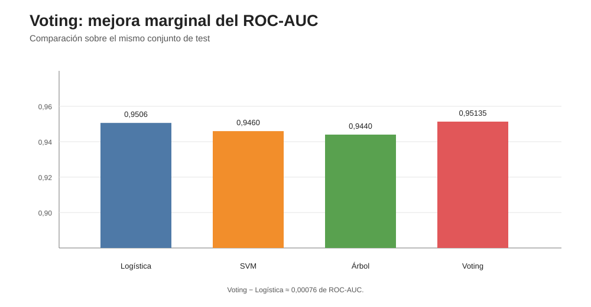

# Informe — Voting binario

## 1. Objetivo

Se evaluó si un ensamble Soft Voting de Regresión Logística, SVM RBF y Árbol de Decisión aportaba una mejora respecto de los modelos individuales del bloque 03.

Los tres modelos usan las configuraciones previamente seleccionadas y el ensamble utiliza pesos iguales. Para el SVM se emplea calibración sigmoide mediante `CalibratedClassifierCV`, de modo que pueda aportar probabilidades al Soft Voting sin usar la opción deprecada `SVC(probability=True)`.

## 2. Resultado definitivo

**Figura 1. ROC-AUC en test.** El Voting supera apenas a la Regresión Logística en capacidad global de ranking.

| Modelo | Accuracy | Precision | Recall | F1 | ROC-AUC |
|---|---:|---:|---:|---:|---:|
| Logística | 0,9066 | 0,9004 | 0,8067 | 0,8510 | 0,9506 |
| SVM | 0,8979 | 0,9150 | 0,7619 | 0,8315 | 0,9460 |
| Árbol | 0,9057 | 0,9064 | 0,7970 | 0,8482 | 0,9440 |
| Voting soft calibrado | 0,9053 | 0,9080 | 0,7940 | 0,8472 | **0,95135** |

La mejora de ROC-AUC frente a Logística es:

    0,951350 − 0,950590 ≈ 0,00076

Es una diferencia muy pequeña.

Con el umbral estándar de 0,5:

- accuracy es ligeramente menor que en Logística;
- recall es menor;
- F1 es ligeramente menor;
- precision es algo mayor.

## 3. Matriz de confusión del Voting

- verdaderos negativos: 6428;
- falsos positivos: 266;
- falsos negativos: 681;
- verdaderos positivos: 2625.

El ensamble detecta 2625 de los 3306 desertores reales del conjunto de test.

## 4. Interpretación

El resultado sugiere cierta complementariedad entre modelos: el promedio de probabilidades mejora levemente la capacidad global de ordenamiento medida por ROC-AUC.

Sin embargo, esa mejora no se traduce en una mejora generalizada de las métricas dependientes del umbral.

Por eso no corresponde afirmar que Voting sea “mejor” en términos absolutos. La conclusión correcta es:

> El Soft Voting calibrado produjo una mejora marginal en ROC-AUC, pero no superó a la Regresión Logística en accuracy, recall ni F1 con el umbral 0,5.

## 5. Costo computacional

La corrida definitiva tardó aproximadamente **1,14 minutos**.

El costo es mayor que el de Logística y Árbol porque el ensamble entrena tres modelos y además calibra el SVM.

El tiempo de cómputo se interpreta como una característica práctica de esta implementación y hardware, no como una medida de calidad predictiva.

## 6. Qué aprendemos del ensamble

Voting puede ayudar cuando los modelos cometen errores diferentes.

En esta base, los tres modelos individuales ya presentan performances próximas y probablemente explotan muchas señales comunes. Por eso una ganancia de ROC-AUC tan pequeña es compatible con una complementariedad limitada.

No se optimizan pesos después de observar test.

## 7. Conclusión del bloque

El Voting cumple el objetivo metodológico de comprobar si combinar clasificadores distintos aporta valor.

La combinación mejora marginalmente ROC-AUC, pero no todas las métricas. Esto muestra por qué un ensamble no debe suponerse superior de antemano.

**Bloque 05 cerrado.**

El siguiente paso es la **clasificación multiclase**.
