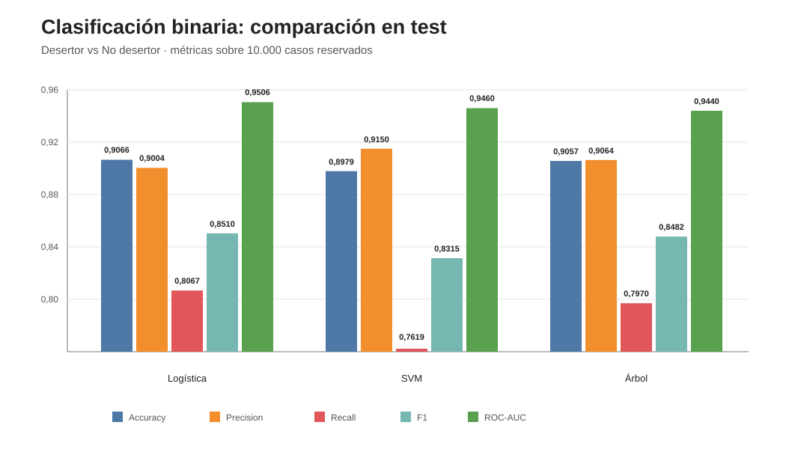

# Informe — Clasificación binaria

## 1. Objetivo

Se compararon tres modelos clásicos para distinguir **Desertor** de **No desertor (Graduado + En Curso)**:

- Regresión Logística;
- SVM con kernel RBF;
- Árbol de Decisión.

Los hiperparámetros se seleccionaron mediante GridSearchCV sobre el conjunto de entrenamiento utilizando ROC-AUC como criterio. El conjunto de test permaneció fuera del ajuste y se utilizó para la evaluación final.

---

## 2. Resultados de validación y test

**Figura 1. Comparación de métricas en test.** Las diferencias entre modelos son pequeñas en accuracy y ROC-AUC; SVM destaca en precision, mientras que Logística presenta mayor recall y F1.

| Modelo | ROC-AUC CV | ROC-AUC test | Accuracy | Precision | Recall | F1 |
|---|---:|---:|---:|---:|---:|---:|
| Logística | 0,9507 | 0,9506 | 0,9066 | 0,9004 | 0,8067 | 0,8510 |
| SVM | 0,9462 | 0,9460 | 0,8979 | 0,9150 | 0,7619 | 0,8315 |
| Árbol | 0,9445 | 0,9440 | 0,9057 | 0,9064 | 0,7970 | 0,8482 |

La proximidad entre ROC-AUC de validación cruzada y test es notable en los tres modelos. No se observa una caída marcada al pasar a datos no utilizados durante la selección de hiperparámetros.

---

## 3. Regresión Logística

Los valores de `C` considerados fueron:

    0,01 · 0,1 · 1 · 10

La mejor configuración fue:

    C = 0,1

Resultados en test:

- accuracy = 0,9066;
- precision = 0,9004;
- recall = 0,8067;
- F1 = 0,8510;
- ROC-AUC = 0,9506.

Dentro de esta comparación, la Regresión Logística mostró el mayor ROC-AUC, recall y F1 de los tres modelos.

Su ROC-AUC de CV (0,9507) y test (0,9506) son prácticamente iguales, lo que indica estabilidad de la performance entre validación y evaluación final para esta partición.

---

## 4. SVM

Se evaluaron:

    C = [0,1; 1; 10]
    gamma = [scale; 0,01; 0,1]

La mejor configuración fue:

    C = 0,1
    gamma = 0,01

Resultados en test:

- accuracy = 0,8979;
- precision = 0,9150;
- recall = 0,7619;
- F1 = 0,8315;
- ROC-AUC = 0,9460.

El SVM obtuvo la mayor precision. Es decir, dentro de las predicciones clasificadas como Desertor, la proporción de verdaderos positivos fue ligeramente superior.

A cambio, presentó el menor recall: dejó sin identificar una proporción mayor de desertores reales que los otros dos modelos.

También tuvo el mayor costo computacional: aproximadamente 3,14 minutos frente a segundos para Logística y Árbol bajo la configuración utilizada.

---

## 5. Árbol de Decisión

La grilla incluyó:

    max_depth = [2, 4, 6, 8, 12, sin límite]
    min_samples_leaf = [1, 10, 50]

La configuración seleccionada fue:

    max_depth = 8
    min_samples_leaf = 50

Resultados en test:

- accuracy = 0,9057;
- precision = 0,9064;
- recall = 0,7970;
- F1 = 0,8482;
- ROC-AUC = 0,9440.

El árbol alcanza una performance cercana a la Regresión Logística en accuracy y F1, aunque con un ROC-AUC algo menor.

La selección de profundidad 8 y hojas de al menos 50 observaciones es especialmente relevante para el siguiente bloque: sugiere que controlar la complejidad mejora la generalización respecto de permitir crecimiento irrestricto.

---

## 6. Comparación entre los modelos

Los tres modelos presentan ROC-AUC superiores a 0,94 y diferencias pequeñas entre CV y test.

La Regresión Logística ofrece el perfil más equilibrado de esta primera comparación:

- mayor ROC-AUC;
- mayor recall;
- mayor F1;
- mayor accuracy por un margen pequeño.

El SVM prioriza precision a costa de recall.

El Árbol ofrece resultados próximos a la Logística con una estructura potencialmente más interpretable, aunque su relación entre complejidad y generalización debe analizarse explícitamente antes de cerrar su interpretación.

Estas diferencias no deben transformarse todavía en una afirmación de superioridad universal de un algoritmo. Describen el comportamiento observado en esta base, con esta partición y estas grillas.

---

## 7. Relación con el EDA

El EDA había mostrado señales académicas y administrativas fuertes. El buen rendimiento global de los tres modelos indica que el conjunto de predictores contiene información suficiente para discriminar Desertor de No desertor.

Sin embargo, este bloque **no permite afirmar todavía cuáles variables explican esa performance**.

Por lo tanto:

- H1–H4 todavía no se consideran confirmadas individualmente;
- la importancia de atributos deberá evaluarse en el bloque correspondiente;
- las correlaciones observadas en el EDA deberán tenerse en cuenta al interpretar esa importancia.

---

## 8. Generalización

La diferencia entre ROC-AUC de CV y test fue muy pequeña:

| Modelo | Diferencia aproximada CV − test |
|---|---:|
| Logística | 0,0001 |
| SVM | 0,0002 |
| Árbol | 0,0004 |

Esto constituye evidencia descriptiva de estabilidad en la partición utilizada.

No sustituye el análisis de curvas de complejidad solicitado por el TP. El siguiente bloque estudiará explícitamente cómo varía la performance al modificar los hiperparámetros que controlan complejidad.

---

## 9. Costo computacional

| Modelo | Tiempo aproximado de GridSearch |
|---|---:|
| Logística | 0,05 min |
| SVM | 3,14 min |
| Árbol | 0,10 min |

El SVM fue sustancialmente más costoso. En este experimento, ese mayor costo no produjo una mejora de ROC-AUC respecto de la Regresión Logística.

El tiempo de cómputo se interpreta como propiedad práctica de esta implementación y hardware, no como una métrica de calidad predictiva.

---

## 10. Conclusión del bloque

Los tres clasificadores lograron una elevada capacidad discriminativa y mostraron resultados estables entre validación cruzada y test.

La Regresión Logística presentó el perfil más equilibrado en las métricas consideradas; SVM mostró mayor precision pero menor recall; y el Árbol alcanzó una performance próxima utilizando una configuración regularizada.

La elección de hiperparámetros relativamente regularizados en los tres casos conduce directamente a la siguiente pregunta del TP:

> **¿cómo cambia la capacidad de generalización a medida que aumenta la complejidad del modelo?**

El bloque siguiente será el análisis de curvas de complejidad.
