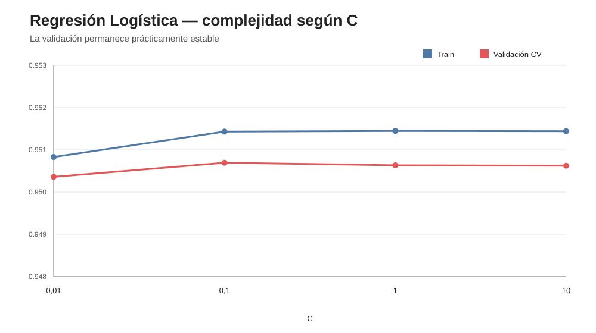
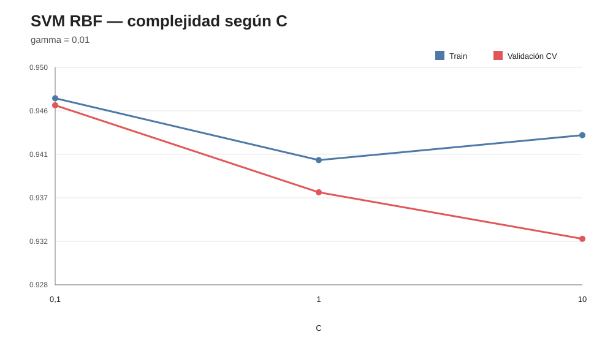
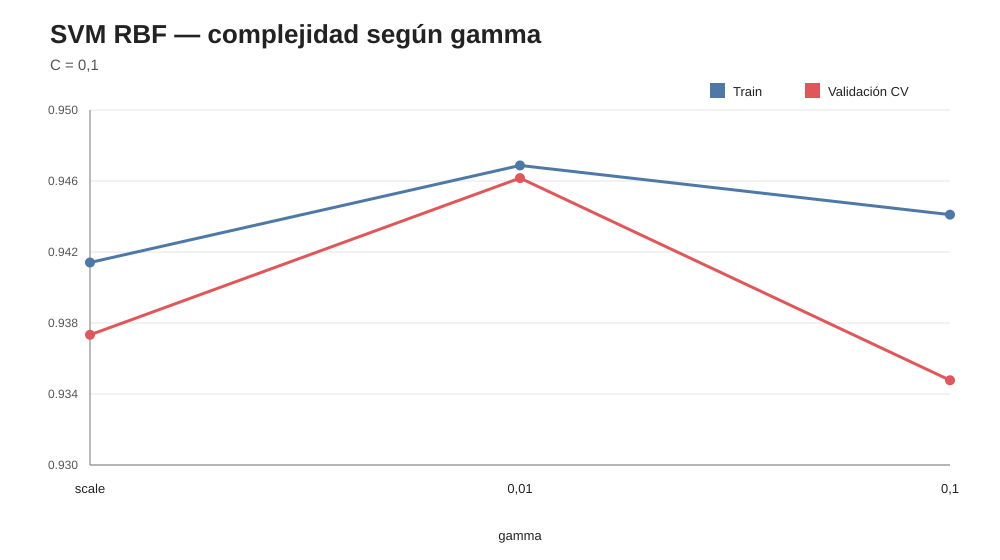
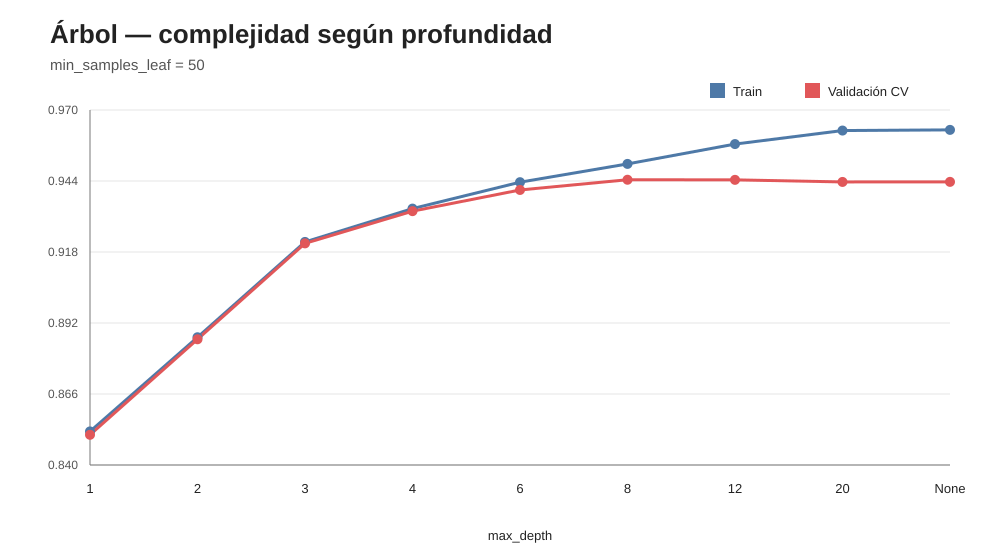
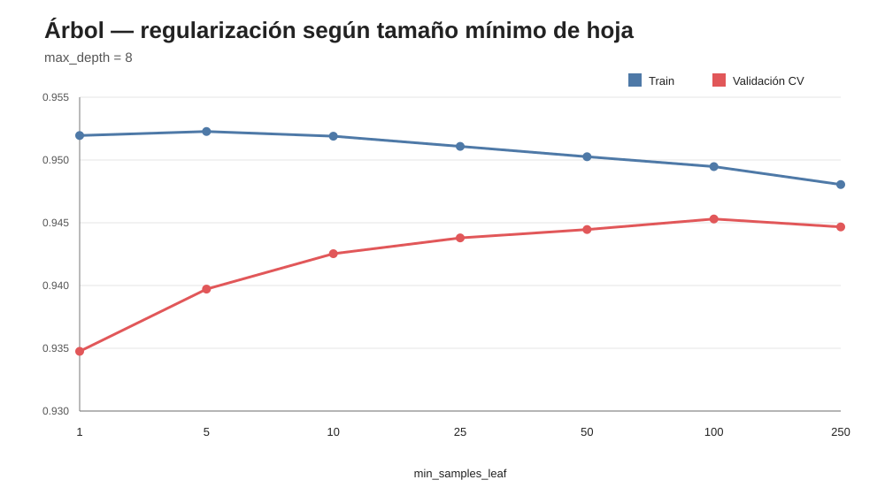

# Informe — Curvas de complejidad y generalización

## 1. Objetivo

Se estudió cómo varía ROC-AUC en entrenamiento y validación cruzada al modificar los hiperparámetros que controlan la complejidad de Regresión Logística, SVM RBF y Árbol de Decisión.

El análisis utiliza exclusivamente el conjunto de entrenamiento. **El test no participa en estas curvas.**

---

## 2. Regresión Logística: una amplia meseta de generalización

La validación aumenta levemente entre C=0,01 y C=0,1 y luego permanece prácticamente constante. Las diferencias entre C=0,1, 1 y 10 son menores a 0,0001 de ROC-AUC.

La brecha train-validación también permanece por debajo de 0,001.

**Lectura:** en el rango estudiado, la Regresión Logística es poco sensible a C y no muestra evidencia relevante de sobreajuste. El valor C=0,1 seleccionado en el bloque 03 se ubica dentro de una región estable.

---

## 3. SVM: configuraciones más complejas no mejoran la validación

### Variación de C con gamma=0,01

La mejor validación corresponde a C=0,1 (ROC-AUC 0,9462). Al aumentar C a 1 y 10, la validación cae y la brecha train-validación aumenta.

### Variación de gamma con C=0,1

Gamma=0,01 alcanza la mayor validación y la menor brecha. Tanto `scale` como 0,1 presentan menor ROC-AUC de validación.

**Lectura:** la configuración seleccionada previamente, C=0,1 y gamma=0,01, se encuentra en la zona de mejor generalización de la grilla estudiada. Una frontera más compleja/local no produjo una mejora.

---

## 4. Árbol: el patrón clásico de underfitting y overfitting

### Profundidad

La validación mejora fuertemente desde profundidad 1 hasta 8:

| max_depth | ROC-AUC train | ROC-AUC validación | brecha |
|---:|---:|---:|---:|
| 1 | 0,8523 | 0,8511 | 0,0012 |
| 4 | 0,9339 | 0,9330 | 0,0009 |
| 6 | 0,9436 | 0,9407 | 0,0028 |
| 8 | 0,9503 | 0,9445 | 0,0058 |
| 12 | 0,9575 | 0,9444 | 0,0131 |
| 20 | 0,9625 | 0,9437 | 0,0188 |
| sin límite | 0,9627 | 0,9437 | 0,0190 |

Hasta profundidad 8, aumentar complejidad mejora claramente la capacidad discriminativa. Después, train continúa mejorando pero validación se estabiliza o empeora y la brecha crece.

Esto permite distinguir:

- **profundidades 1–4:** underfitting;
- **6–8:** zona útil;
- **>8:** comienzo del overfitting.

---

## 5. El tamaño mínimo de hoja confirma el efecto de la regularización

Con profundidad fija en 8, aumentar `min_samples_leaf` desde 1 reduce marcadamente la brecha train-validación:

| min_samples_leaf | ROC-AUC train | ROC-AUC validación | brecha |
|---:|---:|---:|---:|
| 1 | 0,9520 | 0,9348 | 0,0172 |
| 10 | 0,9519 | 0,9425 | 0,0094 |
| 25 | 0,9511 | 0,9438 | 0,0073 |
| 50 | 0,9503 | 0,9445 | 0,0058 |
| 100 | 0,9495 | 0,9453 | 0,0042 |
| 250 | 0,9480 | 0,9447 | 0,0034 |

El máximo de esta curva aparece en 100, que no había sido incluido en la grilla inicial del bloque 03. La diferencia respecto de 50 es sólo ≈0,00084 de ROC-AUC.

No se modifica retrospectivamente el modelo seleccionado. La curva se interpreta como evidencia de una **meseta regularizada aproximadamente entre 50 y 250**, con deterioro claro cuando las hojas son demasiado pequeñas.

---

## 6. Comparación conceptual

Los tres algoritmos responden de manera diferente a la complejidad:

### Regresión Logística
Presenta una meseta amplia: modificar C dentro del rango probado cambia muy poco la validación.

### SVM
Los valores seleccionados de C y gamma presentan mejor generalización que las configuraciones más agresivas estudiadas.

### Árbol
Muestra con claridad el compromiso sesgo-varianza: demasiado simple subajusta; demasiado profundo ajusta cada vez mejor train sin mejorar validación.

---

## 7. Relación con el bloque 03

Los hiperparámetros seleccionados previamente fueron:

- Logística: C=0,1;
- SVM: C=0,1, gamma=0,01;
- Árbol: max_depth=8, min_samples_leaf=50.

Las curvas muestran que las tres configuraciones se encuentran en regiones de buena generalización.

El análisis de complejidad **no utiliza test y no modifica los modelos después de haber observado test**.

---

## 8. Conclusión

Las curvas muestran que un aumento de complejidad no implica necesariamente mejor capacidad predictiva fuera de entrenamiento.

El caso más ilustrativo es el Árbol: aumentar profundidad más allá de 8 continúa elevando ROC-AUC de train, pero no mejora validación y aumenta progresivamente la brecha. A su vez, exigir hojas con más observaciones reduce esa brecha y mejora la generalización.

Por lo tanto, el control de complejidad observado en el bloque 03 no es sólo un resultado del GridSearch: es consistente con el comportamiento de las curvas de aprendizaje respecto de los hiperparámetros.

El bloque de complejidad queda cerrado.
