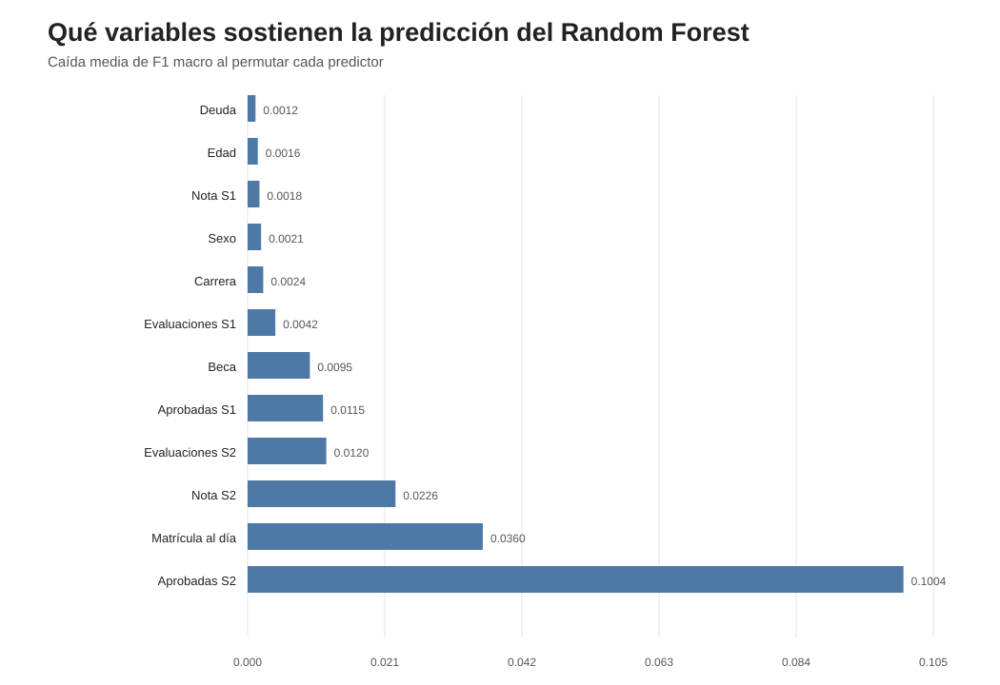
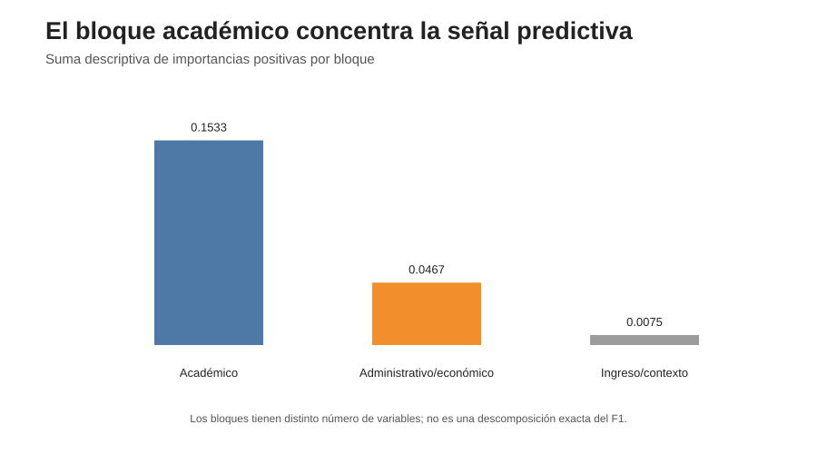

# Informe — Importancia de atributos

## 1. Objetivo

Se evaluó qué variables aportan información predictiva al Random Forest seleccionado en el bloque 07.

La importancia se estimó mediante Permutation Importance sobre validación cruzada dentro de train. El conjunto de test no fue utilizado.

Los F1 macro baseline de los tres folds fueron:

- fold 1: 0,7818;
- fold 2: 0,7821;
- fold 3: 0,7802.

La estabilidad de estos valores indica que el modelo se comportó de manera consistente entre folds.

---

## 2. Ranking de importancia

| Ranking | Variable | Bloque | Caída media de F1 macro | SD |
|---:|---|---|---:|---:|
| 1 | Aprobadas 2.º semestre | Académico | **0,1004** | 0,0087 |
| 2 | Matrícula al día | Administrativo/económico | **0,0360** | 0,0021 |
| 3 | Nota 2.º semestre | Académico | 0,0226 | 0,0025 |
| 4 | Evaluaciones 2.º semestre | Académico | 0,0121 | 0,0020 |
| 5 | Aprobadas 1.er semestre | Académico | 0,0115 | 0,0026 |
| 6 | Beca | Administrativo/económico | 0,0095 | 0,0020 |
| 7 | Evaluaciones 1.er semestre | Académico | 0,0042 | 0,0015 |
| 8 | Carrera | Ingreso/contexto | 0,0024 | 0,0015 |
| 9 | Sexo | Ingreso/contexto | 0,0021 | 0,0017 |
| 10 | Nota 1.er semestre | Académico | 0,0018 | 0,0017 |
| 11 | Edad | Ingreso/contexto | 0,0016 | 0,0011 |
| 12 | Deuda | Administrativo/económico | 0,0012 | 0,0006 |
| 13 | Puntaje de ingreso | Ingreso/contexto | 0,0006 | 0,0012 |

La variable dominante es **materias aprobadas en el segundo semestre**. Permutarla reduce F1 macro aproximadamente 0,10, una caída mucho mayor que la observada para cualquier otro predictor.

---

## 3. Importancia por bloques

| Bloque | n variables | Suma de importancia positiva |
|---|---:|---:|
| Académico | 8 | 0,1533 |
| Administrativo/económico | 3 | 0,0468 |
| Ingreso/contexto | 16 | 0,0075 |

El patrón es muy claro: la mayor parte de la información predictiva relevante se concentra en variables académicas, seguidas por variables administrativas/económicas.

El bloque de ingreso/contexto aporta mucho menos.

Estas sumas se leen sólo de forma descriptiva: los bloques tienen distinto número de variables y existen correlaciones entre predictores.

---

## 4. H1 — Actividad y rendimiento académico

**H1 queda fuertemente respaldada.**

Cinco de las siete variables con mayor importancia pertenecen al bloque académico.

Destaca especialmente:

    Aprobadas S2 → caída media de F1 ≈ 0,100

seguida por:

    Nota S2 → 0,0226
    Evaluaciones S2 → 0,0121
    Aprobadas S1 → 0,0115

Esto es consistente con el EDA, donde las variables académicas mostraban las mayores diferencias entre clases.

---

## 5. H2 — Inactividad académica

El EDA había mostrado que Desertor presenta porcentajes muy altos de valores 0 en aprobadas, notas y evaluaciones.

La importancia predictiva de esas mismas variables es compatible con H2.

Sin embargo, **Permutation Importance permuta la variable completa**, por lo que no distingue entre:

- el aporte de tener valor 0;
- el aporte del nivel cuando el valor es positivo.

Por lo tanto, H2 queda **apoyada de forma indirecta**, pero no aislada de H1.

No necesitamos crear ahora indicadores de cero para “demostrarla”, porque eso abriría una nueva etapa de Feature Engineering y reentrenamiento después de haber evaluado test.

---

## 6. H3 — Variables administrativas/económicas

**H3 queda respaldada, aunque no todas las variables pesan igual.**

### Matrícula al día

Es la segunda variable más importante de todo el modelo:

    caída de F1 macro ≈ 0,0360

Esto confirma que el fuerte patrón descriptivo del EDA también contiene información predictiva fuera del fold de entrenamiento.

### Beca

Presenta importancia:

    ≈ 0,0095

Aporta información predictiva adicional.

### Deuda

Su importancia es bastante menor:

    ≈ 0,0012

Por lo tanto, no corresponde tratar matrícula, beca y deuda como señales equivalentes.

---

## 7. H4 — Señales de ingreso

**H4 recibe respaldo débil.**

Edad:

    importancia ≈ 0,0016
    SD ≈ 0,0011

Puntaje de ingreso:

    importancia ≈ 0,0006
    SD ≈ 0,0012

La edad aporta una señal pequeña pero relativamente consistente.

En cambio, la importancia del puntaje de ingreso es muy pequeña y su variabilidad supera el valor medio.

Esto es coherente con el EDA: las señales disponibles al ingreso eran mucho más moderadas que las variables observadas durante el primer año.

---

## 8. La importancia del segundo semestre domina

El resultado más fuerte del bloque es la concentración de importancia en información del segundo semestre:

- Aprobadas S2 ocupa el primer lugar;
- Nota S2, el tercero;
- Evaluaciones S2, el cuarto.

Esto tiene una implicancia práctica importante:

> el Random Forest completo predice bien utilizando información que ya refleja el desarrollo académico del estudiante.

Por lo tanto, su performance no debe interpretarse como capacidad de detección temprana al momento de la inscripción.

---

## 9. Correlación y reparto de importancia

El ranking individual debe interpretarse con cautela.

El EDA mostró correlaciones elevadas entre variables académicas de ambos semestres. Cuando dos predictores contienen información similar, permutar uno puede ser parcialmente compensado por el otro.

Por eso una importancia baja de Nota S1, por ejemplo, no demuestra que la información de rendimiento del primer semestre sea irrelevante.

Es más adecuado interpretar el **bloque académico como conjunto** que convertir el ranking individual en una jerarquía causal.

---

## 10. Qué hipótesis quedan al final

| Hipótesis | Resultado |
|---|---|
| H1 — Actividad/rendimiento académico | **Fuertemente respaldada** |
| H2 — Inactividad/ceros | **Compatible, pero no aislada de H1** |
| H3 — Administrativo/económico | **Respaldada, con diferencias entre variables** |
| H4 — Señales de ingreso | **Débilmente respaldada** |

---

## 11. Conclusión

La importancia por permutación confirma que la capacidad predictiva del Random Forest se apoya principalmente en información académica del primer año, con un aporte adicional relevante de variables administrativas, especialmente el estado de pago de matrícula.

Las señales disponibles desde la inscripción muestran un aporte mucho menor.

Esto confirma buena parte de la estructura observada en el EDA, pero también matiza las hipótesis: no todas las variables administrativas son igual de informativas y las señales tempranas tienen una contribución predictiva limitada en el modelo completo.

**Bloque 08 cerrado.**

El siguiente paso es integrar todos los resultados en una comparación final de modelos.
