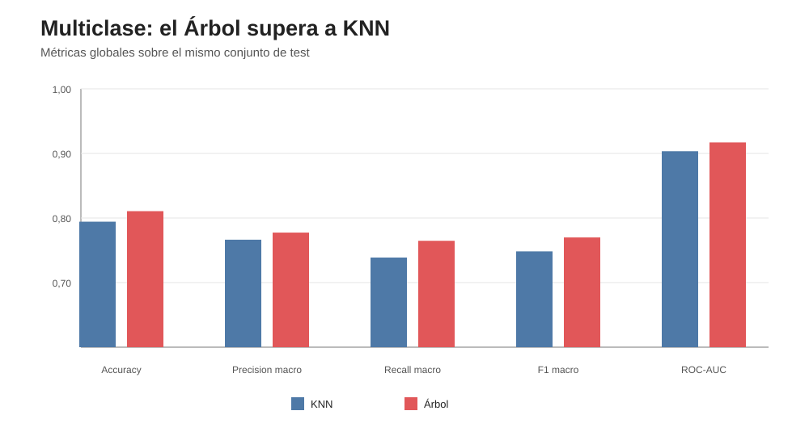
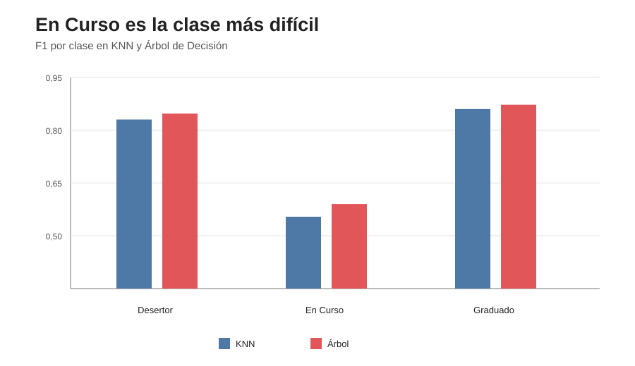

# Informe — Clasificación multiclase

## 1. Objetivo

Se evaluó la clasificación de los tres desenlaces originales:

- Graduado;
- En Curso;
- Desertor.

Se compararon K-NN y Árbol de Decisión. Los hiperparámetros se seleccionaron con GridSearchCV y F1 macro sobre train; test se reservó para la evaluación final.

---

## 2. Resultados globales

| Modelo | Accuracy | Precision macro | Recall macro | F1 macro | ROC-AUC macro OvR |
|---|---:|---:|---:|---:|---:|
| KNN | 0,7943 | 0,7664 | 0,7388 | 0,7483 | 0,9034 |
| Árbol | **0,8106** | **0,7774** | **0,7647** | **0,7699** | **0,9170** |

El Árbol supera a KNN en todas las métricas globales reportadas.

---

## 3. Estabilidad entre validación y test

### KNN

- F1 macro CV = 0,7487
- F1 macro test = 0,7483

### Árbol

- F1 macro CV = 0,7698
- F1 macro test = 0,7699

Las diferencias entre validación y test son mínimas.

**Interpretación:** ambos modelos muestran una elevada estabilidad entre la selección de hiperparámetros y la evaluación final para esta partición.

---

## 4. KNN

Configuración seleccionada:

    n_neighbors = 25
    weights = uniform

Resultados por clase:

| Clase | Precision | Recall | F1 | Support |
|---|---:|---:|---:|---:|
| Desertor | 0,9136 | 0,7613 | 0,8306 | 3306 |
| En Curso | 0,5831 | 0,5279 | 0,5542 | 1953 |
| Graduado | 0,8024 | 0,9270 | 0,8602 | 4741 |

KNN identifica con gran precision a Desertor y alcanza recall muy alto para Graduado.

La principal dificultad es En Curso, cuyo F1 desciende a 0,5542.

---

## 5. Árbol de Decisión

Configuración seleccionada:

    max_depth = 12
    min_samples_leaf = 50

Resultados por clase:

| Clase | Precision | Recall | F1 | Support |
|---|---:|---:|---:|---:|
| Desertor | 0,8887 | 0,8094 | 0,8472 | 3306 |
| En Curso | 0,6033 | 0,5771 | 0,5899 | 1953 |
| Graduado | 0,8403 | 0,9076 | 0,8726 | 4741 |

El Árbol mejora F1 para las tres clases respecto de KNN.

La mejora más importante conceptualmente es que también incrementa el desempeño en En Curso, aunque esta sigue siendo la clase más difícil.

---

## 6. La clase En Curso es el principal desafío

En ambos modelos:

- Graduado tiene el F1 más alto;
- Desertor presenta un F1 también elevado;
- En Curso es claramente la clase peor clasificada.

Esto es coherente con lo observado en el EDA: En Curso presenta características intermedias y no constituye simplemente el opuesto de Desertor ni una copia de Graduado.

La etapa binaria ocultaba esta dificultad porque En Curso se agrupaba con Graduado dentro de No desertor.

---

## 7. KNN vs Árbol

El Árbol obtiene:

- +0,0163 de accuracy;
- +0,0216 de F1 macro;
- +0,0135 de ROC-AUC macro OvR aproximadamente.

Además mejora recall de Desertor:

    0,8094 vs 0,7613

y recall de En Curso:

    0,5771 vs 0,5279

La diferencia no debe interpretarse como superioridad universal del Árbol. Describe la performance observada en esta base y con estas grillas.

---

## 8. Qué nos dice este bloque sobre el problema

El cambio de binario a multiclase revela información que antes quedaba oculta.

Cuando Graduado y En Curso se fusionaban, la tarea era simplemente detectar Desertor.

Ahora el modelo debe resolver simultáneamente:

- Desertor vs resto;
- Graduado vs resto;
- En Curso vs ambos.

La dificultad de En Curso explica parte de la reducción de performance global respecto de la tarea binaria.

---

## 9. Limitación de las grillas

KNN seleccionó el mayor valor de `n_neighbors` probado (25).

El Árbol seleccionó el mayor `min_samples_leaf` probado (50).

Eso sugiere que las zonas de mejor regularización podrían extenderse más allá de la grilla.

Sin embargo, después de haber observado test no se amplía la búsqueda. Se registra como una limitación del diseño de la grilla original.

---

## 10. Conclusión

El Árbol de Decisión presentó mejor desempeño que KNN en la tarea de tres clases y mantuvo una gran estabilidad entre CV y test.

La principal dificultad de ambos modelos fue identificar correctamente la clase En Curso.

El resultado confirma que la clasificación multiclase contiene una estructura más compleja que la tarea binaria y que agrupar Graduado y En Curso simplifica sustancialmente el problema.

**Bloque 06 cerrado.**

El siguiente paso es comparar ensambles basados en árboles: Bagging/Random Forest y Boosting.
