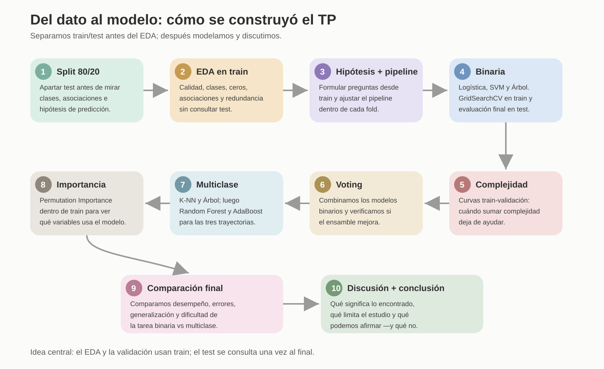

# Guía paso a paso del TP

Esta guía explica **por qué hicimos cada etapa** y cómo se conecta con la siguiente. No reemplaza el informe final: sirve para estudiar, defender el trabajo y no perder el hilo metodológico.

**Orden metodológico corregido:** primero separar train/test; después explorar sólo train y formular hipótesis; luego ajustar por CV en train y evaluar al final en test. La primera versión histórica del EDA examinó test, por lo que sus métricas actuales sirven como evaluación exploratoria, no como confirmación nueva.

## 1. Separar datos y hacer EDA sólo en train

Después de apartar 10.000 filas para test mediante una partición 80/20 estratificada por las tres clases (semilla 42), el EDA se calculó sobre 40.000 filas de train. Fue el punto de partida para entender **qué problema teníamos delante**. Revisamos estructura y calidad de la base, distribución de las tres clases, variables numéricas y categóricas, frecuencia de ceros, categorías pequeñas y relaciones entre predictores.

El hallazgo principal fue que la separación entre las clases aparecía sobre todo en el bloque académico. En los desertores había mucha mayor frecuencia de ceros y, aun entre quienes registraban valores positivos, el rendimiento era menor. También aparecieron asociaciones administrativas y una fuerte redundancia entre variables académicas de primer y segundo semestre.

**¿Para qué sirvió?** Para formular preguntas e hipótesis. El EDA no se usó para decidir qué variable dejar ni para demostrar qué predictor era importante fuera de muestra.

## 2. Hipótesis — convertir observaciones en preguntas

Del EDA surgieron tres hipótesis:
- **H1:** las variables académicas del primer año serán las más informativas.
- **H2:** las variables administrativas y de ingreso aportarán información adicional, pero menor.
- **H3:** la tarea multiclase será más difícil que la binaria, especialmente para En Curso.

## 3. Preprocesamiento — preparar datos dentro de train

La partición se hizo antes del EDA. El test ya había sido observado en la versión histórica del EDA, y no se debe consultar para modificar las decisiones actuales.

El preprocesamiento quedó dentro de pipelines: imputación, escalado cuando correspondía y One-Hot Encoding. Así, cada transformación se aprende usando sólo los datos disponibles dentro de train o del fold correspondiente.

## 4. Clasificación binaria — primera formulación

La tarea fue **Desertor vs No desertor**. Se compararon Regresión Logística, SVM y Árbol de Decisión. Los hiperparámetros se eligieron mediante GridSearchCV con validación cruzada estratificada de 3 folds dentro de train, usando ROC-AUC.

## 5. Curvas de complejidad — entender generalización

Se estudió cómo cambia el desempeño en train y validación al aumentar la complejidad. En el Árbol, profundidades mayores siguieron mejorando train pero dejaron de mejorar validación: una señal de sobreajuste.

## 6. Soft Voting — probar si combinar ayuda

Se combinaron Logística, SVM y Árbol mediante Soft Voting. El resultado mostró que combinar modelos no garantiza una mejora sustancial: el ROC-AUC subió muy poco y F1/recall no mejoraron.

## 7. Clasificación multiclase — conservar las tres trayectorias

Se conservaron **Graduado, En Curso y Desertor**. Se evaluaron K-NN y Árbol, y luego Random Forest como bagging y AdaBoost como boosting. El criterio principal fue F1 macro.

## 8. Importancia por permutación — interpretar qué usa el modelo

La importancia se estimó con Permutation Importance dentro de train, usando validación cruzada interna. Las variables académicas del primer año dominaron la señal predictiva.

**Cuidado:** importancia predictiva no significa causalidad y las variables correlacionadas pueden repartirse la importancia.

## 9. Comparación final — unir todas las piezas

Se compararon desempeño, estabilidad entre CV y test, complejidad, errores por clase e importancia de atributos. La tarea binaria resultó más fácil y la mayor señal predictiva apareció en información académica generada durante el primer año.

## 10. Discusión y conclusión — responder la pregunta

El resultado central no es sólo qué modelo ganó. La lectura más importante es que **alta capacidad predictiva no equivale a detección temprana**: varias de las señales más fuertes aparecen cuando la trayectoria académica ya está en curso.

La discusión también explicita las limitaciones: datos sintéticamente aumentados y transformados, una única partición final train/test, ausencia de validación externa, redundancia entre predictores y la particular dificultad conceptual de la clase En Curso.
