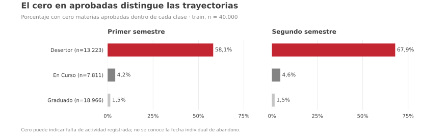
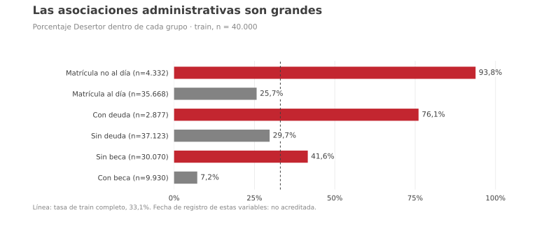
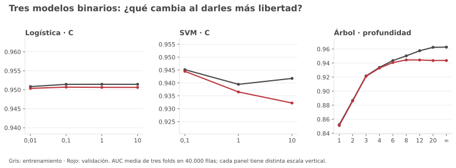
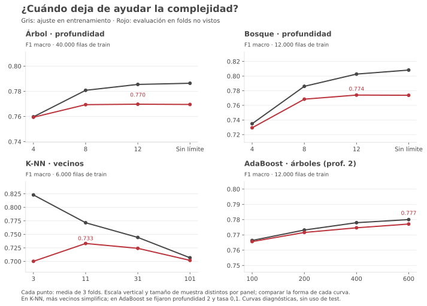
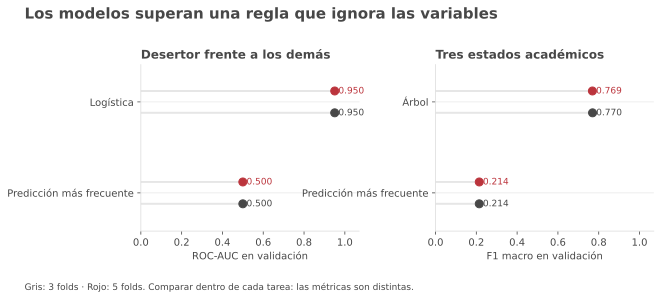
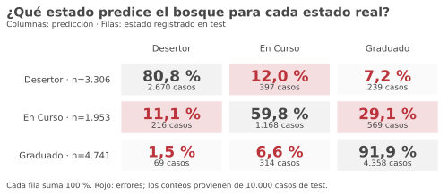
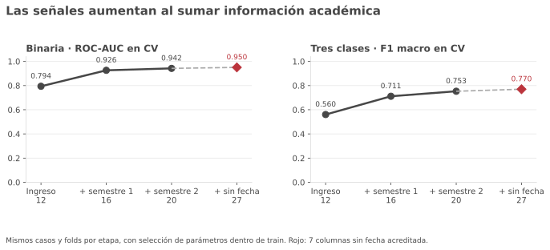
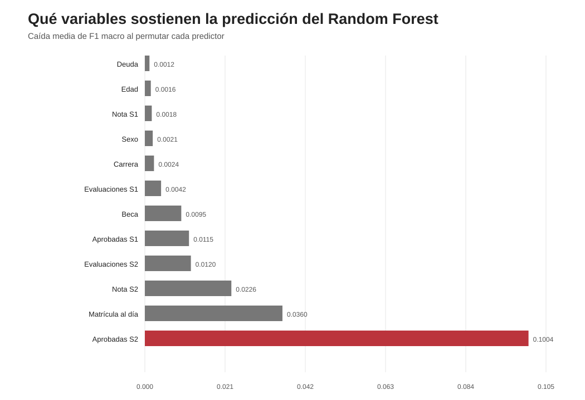

# Trabajo práctico 1 — Aprendizaje Automático

## Predicción de deserción y trayectoria académica en educación superior politécnica

**Tema:** clasificación de deserción y desempeño académico en educación superior  
**Integrantes:** [completar]  
**Curso:** Aprendizaje Automático — 2026

---

## Resumen

Se compararon modelos de clasificación para distinguir Desertor de No desertor y, por separado, Desertor, En Curso y Graduado. Se utilizaron 50.000 registros y 27 variables de una versión sintéticamente aumentada de datos de estudiantes universitarios. La exploración de variables y la elección de parámetros se realizaron en entrenamiento. En la tarea binaria, la Regresión Logística obtuvo ROC-AUC 0,9506; combinar modelos por votación elevó este valor a 0,9514. En tres clases, Random Forest alcanzó F1 macro 0,7808 y En Curso fue la clase más difícil de reconocer. Una comparación por etapas dentro de entrenamiento mostró una mejora marcada al sumar variables del primer semestre; las variables administrativas sin fecha acreditada se analizaron aparte. Las curvas de complejidad, una regla de predicción trivial y una validación con cinco folds ayudaron a interpretar la estabilidad de los resultados. Los modelos completos incluyen información del año entero: su precisión no demuestra capacidad para avisar tempranamente de una deserción.

---

# Introducción

La deserción universitaria es un problema relevante porque no depende de una única característica del estudiante, sino de una combinación de factores personales, académicos y administrativos que aparecen en distintos momentos de la trayectoria educativa. En este trabajo analizamos una base derivada de estudiantes del Instituto Politécnico de Portalegre, una institución pública portuguesa, que reúne información disponible al momento de la inscripción, variables administrativas y datos de rendimiento durante el primer año [1,2]. Estudiamos qué tan bien se distinguen distintos desenlaces académicos en formulaciones binaria y multiclase.

Los trabajos realizados sobre este mismo conjunto de datos muestran que la capacidad predictiva mejora cuando se incorpora información académica generada después del ingreso, especialmente durante el primer semestre [2,3]. Esto plantea una cuestión importante para interpretar los modelos: una variable puede ser muy útil para predecir deserción justamente porque refleja que la trayectoria académica ya comenzó a diferenciarse. Por eso, en este trabajo no nos interesa solamente qué modelo obtiene mejor desempeño, sino también qué tipo de información sostiene esa predicción y en qué momento aparece. Distinguimos así entre señales disponibles desde el ingreso, variables administrativas y económicas, y variables académicas del primer año. El análisis es predictivo y no pretende establecer relaciones causales.

A partir del análisis exploratorio planteamos tres hipótesis. **H1:** las variables de actividad y rendimiento académico del primer año serán las más informativas para predecir la trayectoria de los estudiantes. **H2:** las variables administrativas y aquellas disponibles al momento del ingreso también aportarán información, aunque en menor medida que el rendimiento académico. **H3:** en la tarea de tres clases, `En Curso` tendrá menor sensibilidad y F1 por clase que `Desertor` y `Graduado`; al agruparlo con `Graduado` como No desertor, la evaluación binaria dejará de contar los errores entre esos dos estados. Si `En Curso` obtiene métricas por clase similares, o si casi nunca se confunde con `Graduado`, H3 se debilita. Para contrastar las hipótesis se compararon clasificadores, sus curvas de complejidad y la importancia predictiva de las variables.

---

# Materiales y métodos

## i) Datos y variables explicativas (E)

El conjunto analizado se construyó a partir de los datos de entrenamiento de la competencia de Kaggle “Classification with an Academic Success Dataset”, Playground Series Season 4 Episode 6 [4]. Esa competencia utiliza datos sintéticos generados a partir del dataset original de UCI “Predict Students’ Dropout and Academic Success” [2]. Para conformar este conjunto se tradujeron y renombraron variables, se agruparon categorías, se reescalaron notas y se realizó un submuestreo estratificado a 50.000 observaciones. En consecuencia, los resultados describen este conjunto transformado y no deben interpretarse como una réplica exacta de la cohorte original.

La base contiene **50.000 registros, 27 predictores y una variable respuesta**. De los predictores, 11 son numéricos y 16 categóricos. Doce son candidatos de ingreso, siete variables administrativas y familiares carecen de fecha de captura acreditada, cuatro corresponden al primer semestre y cuatro al segundo. La disponibilidad real al ingreso requiere confirmación de la fuente. Para el EDA y la tarea multiclase se realizó primero una partición **80 % entrenamiento (40.000) / 20 % prueba (10.000)**, con semilla 42 y estratificación por las tres clases. La proporción permitió explorar y entrenar con una muestra amplia y reservar casos para evaluación. El **análisis exploratorio (EDA) se calculó sólo en entrenamiento** para describir calidad y distribución de los datos e identificar asociaciones que motivaran H1–H3; estas asociaciones no prueban capacidad predictiva. Una exploración preliminar anterior había observado las etiquetas de toda la base, incluido el conjunto de prueba: por ello su evaluación posterior no constituye una confirmación independiente nueva.

En los 40.000 casos de entrenamiento, la etiqueta que queremos predecir se distribuyó así: Graduado 18.966 (47,42 %), Desertor 13.223 (33,06 %) y En Curso 7.811 (19,53 %). Se conservaron estas proporciones mediante la partición estratificada y se eligieron F1 macro y métricas por clase para que el análisis multiclase no quede resumido por la clase mayoritaria. No se aplicó remuestreo por defecto.

**Calidad de la muestra y decisiones antes de modelar (sólo train):**

- **213 repeticiones de fila completa**, incluida la respuesta, y **235 repeticiones de los 27 predictores** (ambas cuentan filas adicionales a la primera). En **22 perfiles** idénticos hay respuestas distintas (49 filas). Se conservaron los registros porque no hay identificador personal para verificar duplicaciones; las coincidencias entre entrenamiento y prueba se analizaron mediante una sensibilidad que cambia únicamente el conjunto evaluado.
- **34 casos en S1 y 62 en S2** tienen más materias aprobadas que inscriptas; en **1 y 3** de ellos, respectivamente, hay aprobadas con cero inscriptas. Se conservaron y documentaron: sin definiciones institucionales no se puede determinar qué valores deberían corregirse.
- No hay faltantes codificados como `NaN`, pero cero aprobadas o nota cero pueden representar distintas situaciones. Se analizó por separado la frecuencia de ceros y el nivel entre valores positivos, sin convertir ceros automáticamente en faltantes ni atribuirles una causa.
- Dos pares de columnas parentales son recodificaciones equivalentes en entrenamiento y siete variables carecen de fecha de registro acreditada. Los pares no se interpretaron como evidencia independiente y las siete columnas sin fecha se incluyeron sólo al utilizar las 27 variables, sin atribuirles disponibilidad al ingreso.

**Figura 1. Bloques de variables y fecha de captura.** Hay 12 candidatas de ingreso (disponibilidad real por verificar), cuatro columnas del primer semestre, cuatro del segundo y siete columnas administrativas/familiares sin fecha documentada. Las siete se usan en el modelo completo, pero no se les asigna un momento temprano. Los modelos completos no representan predicciones realizadas al ingreso.

## ii) Variable respuesta / tarea objetivo (T)

Se trabajó con dos formulaciones. En la tarea **binaria**, Desertor se codificó como clase positiva y Graduado + En Curso como No desertor. En la tarea **multiclase**, se conservaron las tres etiquetas originales: Graduado, En Curso y Desertor. La formulación binaria responde sólo si el registro figura como Desertor o No desertor: tanto `En Curso` como `Graduado` se codifican No desertor, pero **En Curso no se recodifica como Graduado**. La multiclase conserva las tres etiquetas. `En Curso` describe el estado registrado, no garantiza una graduación futura; falta fecha y duración de seguimiento para conocer su desenlace posterior. Para H3 se evalúan recall, F1 y matriz de confusión **dentro de la tarea de tres clases**, sin equiparar directamente sus métricas globales con las de la tarea binaria.

## iii) Manejo de datos y esquemas de clasificación

Para la clasificación binaria se realizó otra partición **80/20** con la misma semilla, estratificando por Desertor/No desertor. En la tarea multiclase se usó la partición estratificada por las tres clases descrita antes; por ello los conjuntos de prueba de ambas tareas tienen 10.000 registros, pero no exactamente las mismas filas. La preparación de datos y el clasificador se integraron en un mismo procedimiento (*pipeline*): cada paso aprendió exclusivamente de los datos con los que se entrenaba el modelo en ese momento. Las variables numéricas se imputaron por mediana; las categóricas, por moda. La base analizada no presentó faltantes, pero se mantuvo la imputación para que el procedimiento también aceptara futuros registros incompletos. Las categorías se convirtieron en columnas indicadoras (codificación *One-Hot*); así, las 27 variables originales se representaron como 77 columnas para los modelos. El EDA no se utilizó para eliminar variables.

Los modelos responden de maneras distintas a las mismas variables: **Logística** combina sus valores para estimar la probabilidad de deserción; **SVM** busca una frontera que separe los grupos; **Árbol** encadena preguntas; **K-NN** usa los casos más cercanos; **AdaBoost** agrega árboles sucesivos atendiendo a los casos difíciles. **Random Forest** agrega árboles entrenados sobre muestras de filas con reemplazo y considera un subconjunto aleatorio de columnas en cada división. Cada árbol estima probabilidades y gana la clase con mayor probabilidad promedio. Las muestras de filas y columnas hacen que los árboles sean diversos; promediar sus respuestas reduce la variación que tendría un solo árbol. Esta variedad permite comprobar si una conclusión depende de un solo clasificador.

Los **hiperparámetros** son decisiones previas al ajuste, como cuántos vecinos considera K-NN o cuán profundo puede crecer un árbol. Para elegirlos se probaron los valores de la Tabla 1 sólo con las 40.000 filas de entrenamiento. Se dividieron en tres partes o *folds*, manteniendo aproximadamente la proporción de clases: cada combinación se entrenó con dos partes y se evaluó con la tercera, repitiendo hasta que cada parte sirvió de validación. Se eligió el mejor promedio de esas tres evaluaciones; luego se entrenó la configuración elegida con todas las filas de entrenamiento y se aplicó a las 10.000 de test. La preparación de los datos se volvió a aprender en cada entrenamiento parcial, sin mirar su parte de validación.

En binario se eligió por **ROC-AUC**, una medida de qué tan bien el modelo ordena Desertor frente a No desertor sin fijar un único umbral. En tres clases se eligió por **F1 macro**: se calcula un F1 para cada clase a partir de precisión (de los que clasificamos en ella, cuántos pertenecían) y sensibilidad o *recall* (de los que pertenecían, cuántos detectamos), y se promedian los tres. Así En Curso cuenta tanto como Graduado aunque tenga menos registros. Las dos puntuaciones responden preguntas diferentes; no se comparan numéricamente entre tareas.

**Tabla 1. Valores probados y elegidos dentro de entrenamiento**

| Tarea y modelo | Qué se probó | Qué se eligió |
|---|---|---|
| Binaria · Logística | C: 0,01; 0,1; 1; 10 | C: 0,1 |
| Binaria · SVM | C: 0,1; 1; 10; gamma: *scale*; 0,01; 0,1 | C: 0,1; gamma: 0,01 |
| Binaria · Árbol | Profundidad: 2; 4; 6; 8; 12; sin límite; mínimo por hoja: 1; 10; 50 | Profundidad: 8; hoja: 50 |
| Tres clases · K-NN | Vecinos: 3; 5; 9; 15; 25; peso: uniforme o distancia | 25 vecinos; uniforme |
| Tres clases · Árbol | Profundidad: 2; 4; 6; 8; 12; sin límite; mínimo por hoja: 1; 10; 50 | Profundidad: 12; hoja: 50 |
| Tres clases · Random Forest | Árboles: 200; 500; profundidad: 12 o sin límite; mínimo por hoja: 1; 50 | 500 árboles; sin límite; hoja: 1 |
| Tres clases · AdaBoost | Profundidad de árbol base: 1; 2; árboles: 100; 200; 400; tasa: 0,05; 0,1 | Profundidad: 2; 400 árboles; tasa: 0,1 |

*En Random Forest se mantuvo fijo `max_features="sqrt"`. Cada fila resume las combinaciones de la grilla inicial: la segunda grilla del Árbol se presenta en Resultados.*

Se combinaron además Logística, SVM y Árbol mediante **Soft Voting**: se promediaron sus probabilidades por clase con pesos iguales. Para obtener probabilidades del SVM se ajustó una **calibración sigmoide**, con tres folds internos de entrenamiento (`CalibratedClassifierCV`, `ensemble=False`); no se usó test para calibrar ni elegir los pesos. En las predicciones binarias basadas en probabilidades (Logística, Árbol y Soft Voting) se usó la clase de mayor probabilidad, equivalente al umbral 0,5 salvo empates; el SVM individual clasificó por el signo de su función de decisión. La ROC-AUC se calculó con puntuaciones continuas, sin fijar umbral. Se informaron precisión, sensibilidad, F1, ROC-AUC, matrices de confusión y porcentaje total de aciertos (*accuracy*).

Las comprobaciones complementarias responden a preguntas distintas y se hicieron en **entrenamiento**. Para estudiar sobreajuste se variaron por separado los parámetros de Logística, SVM y Árbol binarios, y los de Árbol, K-NN, Random Forest y AdaBoost multiclase, comparando la puntuación en los folds usados para ajustar (gris) con la del fold reservado (rojo). Para ahorrar tiempo, las curvas de bosque y AdaBoost usaron 12.000 filas, y la de K-NN 6.000; sus valores absolutos no reemplazan los modelos finales entrenados con 40.000. En la curva nueva de AdaBoost se fijaron profundidad 2 y tasa 0,1, como en el modelo final, y se recorrieron 100–600 árboles. Se ensayó una segunda grilla del Árbol con 12 combinaciones de profundidad y tamaño de hoja. Además, **con los mismos 40.000 registros y tres folds**, se ampliaron los bordes de K-NN (25, 35, 51 vecinos con peso uniforme) y AdaBoost (200, 400, 600 árboles con profundidad 2 y tasa 0,1), variando sólo un parámetro por comparación. Estas comprobaciones posteriores a la búsqueda original no reeligieron los modelos ni produjeron nuevas métricas de test. También se compararon tres y cinco folds con parámetros fijos, y el mismo Árbol con 10.000, 20.000 y 40.000 filas. Un **Dummy** que siempre predice la clase más frecuente sirvió de referencia. Al cambiar la muestra también cambian los casos de validación: esas pequeñas diferencias no forman una curva de aprendizaje formal.

Para estudiar **cuándo aparece la señal**, en un análisis por etapas se compararon, con el mismo split estratificado por las tres clases, 12 variables candidatas de ingreso, 16 al sumar primer semestre y 20 al sumar segundo. Las siete variables restantes, sin fecha acreditada, se añadieron sólo como escenario aparte hasta llegar a 27. Se usaron Logística binaria y Árbol multiclase, con la misma partición y los mismos folds en cada etapa. En el mismo protocolo se compararon 20 y 27 variables y se recalculó la evaluación de test al excluir 103 perfiles cuyos 27 predictores coincidían con alguna fila de entrenamiento; este filtro no cambió el ajuste del modelo. La tarea binaria original usa otra partición, de modo que sus cifras no miden el efecto de agregar variables a esta comparación por etapas.

**Tres clases, entrenamiento y AUC.** K-NN, Árbol, Random Forest y AdaBoost aprendieron directamente las tres etiquetas. En K-NN votan vecinos de las tres clases; en el Árbol y el bosque, cada división calcula Gini considerando las **tres proporciones**; en AdaBoost cada árbol base también distingue las tres etiquetas y la siguiente ronda da más peso a los casos mal clasificados. Por eso no se necesitaron envolturas de entrenamiento: OvR entrenaría tres clasificadores binarios (una clase frente a las demás), y OvO, tres por parejas. La ROC-AUC OvR de los resultados principales se obtuvo **después de entrenar**, comparando la probabilidad de cada clase frente al resto y promediando los tres valores. También se calculó AUC OvO entre pares con **las mismas probabilidades**: son dos resúmenes de una predicción idéntica, no dos entrenamientos diferentes.

En el bosque se fijó `max_features="sqrt"`: en cada división cada árbol pudo elegir entre aproximadamente la raíz cuadrada de las **77 columnas procesadas**. La calidad de la división se midió por impureza de Gini, que refleja cuánto se mezclan las clases en un grupo.

La importancia por permutación se calculó sobre las **27 columnas originales**, antes de convertir las categóricas en 77 indicadores: se alteró una columna completa en cada fold de validación y se observó cuánto caía el F1 macro del pipeline. Así las categorías derivadas de una misma columna se alteraron juntas. Se repitió cinco veces por columna y fold, sin utilizar test.

---

# Resultados

## Exploración inicial

Los cálculos y figuras del EDA presentado se obtuvieron de las **40.000 filas de entrenamiento (80 %)**. Se examinaron los 27 predictores y se seleccionaron las Figuras 2 y 3 para mostrar los contrastes que motivan H1–H3. Estas diferencias descriptivas motivan las hipótesis, sin demostrar por sí solas capacidad de predicción.

**H1 — Información académica.** Dentro de Desertor, **58,1 %** tiene cero materias aprobadas en S1 y **67,9 %** en S2; en En Curso son **4,2 %** y **4,6 %**, y en Graduado alrededor de **1,5 %** en ambos semestres. La Figura 2 hace visible este contraste. Entre quienes tienen aprobadas positivas, las medianas S1 son **4/5/6** y S2 **3/4/6** para Desertor/En Curso/Graduado. Así surge la hipótesis de que actividad y rendimiento del primer año ayudan a clasificar: primero se observa una asociación, después se contrasta utilidad predictiva en validación. Un cero no permite afirmar que la persona haya rendido y desaprobado.

**Figura 2. Ceros académicos por clase y semestre en train.** Cada porcentaje usa como denominador los registros de esa clase; el rojo destaca Desertor. Las variables S2 aparecen más tarde y la fecha individual de abandono no está disponible.

**H2 — Información administrativa y de ingreso.** En train la deserción fue **93,79 %** con matrícula no al día (n=4.332), **76,05 %** con deuda (n=2.877) y **7,21 %** con beca (n=9.930), frente al **33,06 %** general. La Figura 3 muestra también los grupos de comparación: la asociación es grande, pero matrícula, deuda y beca **no tienen fecha de registro acreditada** y no deben presentarse como señales tempranas ni como causas. Entre los candidatos de ingreso, la mediana de edad fue 22 años en Desertor y 19 en En Curso/Graduado, mientras el puntaje de ingreso se solapa (medianas 61/61/63). Esto motiva comparar información de ingreso y administrativa con la académica, sin asumir que la primera predice igual de bien.

**Figura 3. Tasa de Desertor dentro de cada categoría en train.** Línea punteada: 33,06 % en train; rojo para tasas por encima de esa referencia. Cada barra indica su n. No se conoce si las tres variables administrativas se midieron antes del desenlace.

**H3 — Qué pasa con `En Curso`.** La clase representa **7.811/40.000 (19,53 %)** en train. Comparte con Graduado una mediana de edad de **19 años**, pero, entre quienes tienen al menos una materia aprobada, registra medianas de **5 frente a 6** en S1 y **4 frente a 6** en S2. Estas cifras describen algunas semejanzas y diferencias; no bastan para afirmar que las dos clases sean indistinguibles. La pregunta comprobable es si un clasificador de **tres clases** reconoce peor a `En Curso` que a las otras dos, y si se equivoca sobre todo al llamarlo `Graduado` o `Desertor`. Por eso se selecciona el modelo con **F1 macro en CV de train** y después se reportan **recall y F1 por clase y matriz de confusión** en test. En el binario las dos categorías integran `No desertor`: confundirlas entre sí no se cuenta como error de esa tarea. La dificultad real se establece con predicciones, no con las medianas del EDA.

## Clasificación binaria

**Tabla 2. Resultados binarios en los mismos 10.000 registros de test**

| Modelo | Aciertos | Precisión | Sensibilidad | F1 | ROC-AUC |
|---|---:|---:|---:|---:|---:|
| Logística | **0,9066** | 0,9004 | **0,8067** | **0,8510** | 0,9506 |
| SVM | 0,8979 | **0,9150** | 0,7619 | 0,8315 | 0,9460 |
| Árbol | 0,9057 | 0,9064 | 0,7970 | 0,8482 | 0,9440 |
| Soft Voting | 0,9053 | 0,9080 | 0,7940 | 0,8472 | **0,9514** |

*La precisión y sensibilidad se refieren a Desertor; en esta tabla aciertos equivale a accuracy.*

La Regresión Logística alcanzó ROC-AUC **0,9506** y F1 **0,8510** en test. La combinación de modelos por votación elevó la AUC hasta **0,9514**: la ganancia fue **0,0008**, sin mejorar F1 ni sensibilidad. La tabla permite ver las cinco medidas sin convertir una diferencia tan pequeña en una afirmación de superioridad fuera de esta base.

## Complejidad y generalización

Una **curva de complejidad** prueba varios valores de un parámetro manteniendo los otros fijos. Si el rendimiento en las filas usadas para entrenar crece, pero en las filas reservadas para validación se estanca o cae, el modelo puede estar aprendiendo detalles difíciles de repetir (*sobreajuste*). Las curvas se calcularon sólo con train; cada punto resume tres particiones.

En binario, Logística varió muy poco al cambiar su parámetro C: la AUC de validación fue 0,9504 con C=0,01 y aproximadamente 0,9507 con C=0,1, 1 o 10. Esta curva usa el split original estratificado por la etiqueta **binaria**; la comparación con Dummy y de tres frente a cinco folds usa el split estratificado por **tres clases** y obtiene 0,9503 con tres folds (0,950 en la Figura 6 por redondeo). Son validaciones sobre conjuntos ligeramente diferentes. Para SVM se modificaron C y gamma por separado; la mejor región entre las probadas fue C=0,1 y gamma=0,01. En el Árbol, al fijar al menos 50 casos por hoja, crecer hasta profundidad 8 elevó la AUC de validación a **0,9445**; crecer más aumentó sobre todo el ajuste en entrenamiento (Figura 4). Al fijar profundidad 8, exigir 100 casos por hoja dio AUC **0,9453**, frente a **0,9445** con 50: es una diferencia pequeña, observada en la curva posterior a la elección original y que no justificó reajustar el resultado final mirando test.

**Figura 4. Tres clasificadores binarios.** Gris: entrenamiento; rojo: validación. Las escalas verticales difieren para mostrar cómo cambia cada modelo cuando varía un parámetro; el Árbol se separa de la validación al profundizar más allá de 8.

La Figura 5 extiende la pregunta a los cuatro clasificadores de tres clases: ¿más profundidad, más vecinos o más árboles ayuda a reconocer las tres etiquetas? En Random Forest, la validación sube de **0,729** a **0,774** entre profundidades 4 y 12, pero no mejora al quitar el límite de profundidad mientras el ajuste a train continúa creciendo. En K-NN, **3 vecinos** se ajustan demasiado a train (0,823 frente a 0,700 en validación); **11** alcanzan mayor F1 de validación (**0,733**) con **6.000 filas**. La búsqueda que eligió **25 vecinos** usó **40.000 filas** y otra lista de k: no son selecciones hechas con los mismos casos y valores probados. En la curva nueva de AdaBoost, con profundidad 2 fija, la validación **continúa subiendo** de **0,7656** con 100 árboles a **0,7771** con 600; tampoco aparece una caída al llegar a 400. Más complejidad no produce siempre sobreajuste: en el rango probado AdaBoost aún gana validación. Estas curvas usan tamaños de muestra distintos, indicados en cada panel; se compara la forma de cada una, no sus alturas para elegir el modelo final.

**Figura 5. Entrenamiento frente a validación en tres clases.** Cada punto promedia tres folds; se modifica un parámetro por vez. AdaBoost mantiene árboles de profundidad 2 y tasa 0,1; su curva de 12.000 filas no representa el resultado final con 40.000. Los ejes verticales y las cantidades de filas difieren entre paneles.

## Referencias y sensibilidad de las decisiones

Primero se comparó el modelo con una **regla trivial**: el Dummy siempre responde con la clase más frecuente, sin consultar las 27 variables. En la tarea binaria obtiene AUC **0,500**, frente a **0,950** de la Logística con C=0,1. En tres clases obtiene F1 macro **0,214**, frente a **0,770** del Árbol de profundidad 12 y hoja mínima 50. Esta referencia muestra que las variables aportan información; no demuestra utilidad para intervenir a tiempo.

**Figura 6. Referencia trivial y tres frente a cinco folds, sólo en entrenamiento.** Gris representa tres folds; rojo, cinco. Las dos tareas usan medidas diferentes y se leen por separado.

Con **cinco folds** en vez de tres, los mismos modelos y parámetros fijos dieron AUC binaria **0,9505** frente a **0,9503** en Logística y F1 macro **0,7690** frente a **0,7698** en Árbol. Las medias cercanas sugieren que esta conclusión no depende mucho de escoger tres o cinco divisiones de *esta muestra*; no prueban estabilidad entre cohortes. La comprobación del bosque usó 12.000 filas y 80 árboles: **0,7741** con tres folds y **0,7726** con cinco; no se compara su nivel con el bosque final de 500 árboles ajustado con 40.000.

Después se ensayó **una segunda grilla de dos parámetros** del Árbol: cuatro profundidades por tres tamaños mínimos de hoja, incluidos valores no probados inicialmente. Con las 40.000 filas de train y tres folds, profundidad 12 / hoja 50 obtuvo F1 macro **0,7698**; profundidad 8 / hoja 50 obtuvo **0,7694**. Un árbol sin límite / hoja 10 alcanzó **0,8250 en entrenamiento**, pero sólo **0,7446 en validación**. La diferencia de **0,0004** entre las dos mejores opciones es demasiado pequeña para sostener una ventaja práctica. La grilla sirve para ver qué ocurre al variar dos decisiones simultáneamente; no identifica una configuración universal.

Se examinaron también los **bordes** de las grillas de K-NN y AdaBoost en los mismos 40.000 registros y tres folds de train. El promedio de F1 macro fue:

| Modelo (parámetro fijo) | Valor probado → F1 macro en CV |
|---|---|
| K-NN (peso uniforme) | 25 → **0,7487** · 35 → 0,7475 · 51 → 0,7453 |
| AdaBoost (profundidad 2; tasa 0,1) | 200 → 0,7623 · 400 → 0,7715 · 600 → **0,7747** |

En K-NN, ampliar el rango no mejoró el promedio más allá de 25; las diferencias son pequeñas y no demuestran un óptimo universal. En AdaBoost, 600 supera a 400 en esta CV y el borde continúa abierto. Como esta extensión se hizo después de observar el test original, se informa como **sensibilidad exploratoria de entrenamiento**; no se reemplaza la Tabla 3 por una estimación de test nueva.

También se aplicó el mismo Árbol a subconjuntos de **10.000, 20.000 y 40.000 filas** de train. Sus F1 macro de validación fueron **0,7729; 0,7672 y 0,7698**. No hay un aumento ordenado con el tamaño; como cada validación contiene casos distintos, no se interpreta que 10.000 filas sean mejores. Para responder esa pregunta haría falta fijar los casos de evaluación y repetir la extracción de muestras.

Finalmente, una misma predicción multiclase puede resumirse de dos modos: en el Árbol de 40.000 filas, tres folds dieron AUC macro **0,9159 con OvR** (cada clase frente al resto) y **0,9071 con OvO** (comparaciones por parejas). El modelo y sus probabilidades son idénticos; cambió la forma de calcular AUC. La selección de hiperparámetros de este trabajo siguió basándose en F1 macro.

## Clasificación multiclase y ensambles

**Tabla 3. Resultados multiclase en los mismos 10.000 registros de test**

| Modelo | Aciertos | Precisión macro | Sensibilidad macro | F1 macro | ROC-AUC OvR |
|---|---:|---:|---:|---:|---:|
| K-NN | 0,7943 | 0,7664 | 0,7388 | 0,7483 | 0,9034 |
| Árbol | 0,8106 | 0,7774 | 0,7647 | 0,7699 | 0,9170 |
| Random Forest | **0,8196** | **0,7896** | **0,7750** | **0,7808** | **0,9254** |
| AdaBoost | 0,8182 | 0,7874 | 0,7707 | 0,7776 | 0,9219 |

*«Macro» da el mismo peso a las tres clases; AdaBoost obtuvo el F1 más alto específicamente para Desertor.*

**H3 se sostiene descriptivamente en esta evaluación:** En Curso obtuvo el menor F1 en los cuatro modelos: **0,5542** con K-NN, **0,5899** con Árbol, **0,6096** con Random Forest y **0,6006** con AdaBoost. En el bosque, la sensibilidad fue **0,5981** para En Curso, frente a **0,8076** para Desertor y **0,9192** para Graduado. La Figura 7 muestra el destino de los errores: de los **1.953** registros reales En Curso, **569 (29,1 %)** fueron etiquetados Graduado y **216 (11,1 %)**, Desertor. La confusión con Graduado es la más frecuente; en la tarea binaria esos 569 casos no cuentan como error porque ambas clases reciben No desertor. Esta comparación entre etiquetas no atribuye un desempeño binario al bosque, pues el binario se entrenó por separado. Random Forest obtuvo F1 macro **0,7808** en test; AdaBoost, el F1 más alto específicamente para Desertor (**0,8562**).

**Figura 7. Estado real frente a estado predicho por Random Forest en test.** Cada fila suma 100 % y muestra el número de casos; el rojo señala errores. El bosque usa los parámetros elegidos en train; la matriz se obtuvo sin volver a optimizar con test.

## Qué cambia al sumar información del primer año

La Figura 8 compara **conjuntos acumulativos de variables**, manteniendo los mismos registros y folds dentro de cada tarea. En binario, la AUC de validación pasa de **0,7941** con las 12 variables candidatas al ingreso a **0,9262** al agregar cuatro del primer semestre y **0,9422** al agregar cuatro del segundo. En tres clases, el F1 macro del Árbol pasa de **0,5603** a **0,7115** y **0,7529**. Estas diferencias hablan de información que se va sumando, no de que el primer algoritmo sea peor que el segundo. La mejora mayor aparece al incorporar el primer semestre.

**Figura 8. Información acumulada y puntuación media en tres folds de train.** El tramo rojo añade siete variables administrativas/familiares sin fecha de medición documentada: el valor con 27 variables no equivale a una predicción hecha al ingreso. Sin fecha individual de deserción tampoco podemos afirmar que la información de un semestre siempre antecediera al evento.

## Sensibilidad a perfiles repetidos entre train y test

Como sensibilidad adicional se recalcularon las métricas de **los mismos modelos y predicciones** en test completo (n=10.000) y al excluir 103 registros (1,03 %) cuyo vector de 27 predictores coincidía exactamente con al menos un caso de entrenamiento (n=9.897). En 94 de esos 103 había al menos una coincidencia de etiqueta y en 9 la etiqueta difería; sin ID personal no puede determinarse si representan al mismo estudiante.

| Modelo del análisis complementario | Métrica | Test completo (n=10.000) | Sin los 103 perfiles (n=9.897) |
|---|---|---:|---:|
| Logística binaria, 20 variables | ROC-AUC | 0,9446 | 0,9440 |
| Árbol multiclase, 20 variables | F1 macro | 0,7455 | 0,7448 |
| Logística binaria, 27 variables | ROC-AUC | 0,9518 | 0,9513 |
| Árbol multiclase, 27 variables | F1 macro | 0,7699 | 0,7694 |

*Las puntuaciones corresponden al análisis complementario descrito en Métodos; no son nuevas estimaciones de los clasificadores principales.* Las diferencias (0,0005–0,0007) fueron pequeñas al retirar **estas** coincidencias. El filtro se definió sobre las 27 columnas incluso para los modelos de 20: no descarta perfiles repetidos en subconjuntos de variables, dependencia entre registros parecidos ni la exposición previa de test durante el análisis exploratorio.

## Importancia de atributos

La importancia por permutación del bosque se calculó en tres folds de entrenamiento. Antes de alterar cada variable, sus F1 macro fueron 0,7818, 0,7821 y 0,7802.

**Figura 9. Dependencia del bosque respecto de cada variable.** La barra indica cuánto cae el F1 macro en validación al desordenar una columna; una caída mayor no demuestra causalidad.

La Figura 9 resume la caída del F1 macro al permutar los predictores más relevantes. La mayor fue **0,1004** para materias aprobadas del segundo semestre; la de matrícula al día fue **0,0360**. Las ocho variables académicas acumularon descriptivamente 0,1533 de importancia positiva; las tres administrativo-económicas, 0,0468; y las 16 variables de ingreso/contexto, 0,0075. Estas sumas no representan una descomposición exacta del F1, porque los bloques tienen distinto número de variables y existen predictores correlacionados.

---

# Discusión

La matriz del bosque muestra qué error deja de contar la etiqueta binaria: 569 casos En Curso clasificados como Graduado. Sus puntuaciones no se comparan directamente con las binarias: miden preguntas distintas y, en el análisis original, se reservaron filas de test ligeramente diferentes. Sin seguimiento posterior, tampoco sabemos si quienes figuran En Curso terminarán graduándose o desertando.

Según la importancia por permutación, el bosque depende especialmente de aprobadas y notas del primer año, y también destaca matrícula al día. Esto es compatible con H1 y H2 y con estudios que incorporan rendimiento posterior al ingreso [2,3], pero las columnas correlacionadas pueden compartir señal y la importancia no mide causalidad ni el aporte conjunto exacto de un bloque. Una clasificación con los 27 predictores del año completo no demuestra capacidad de intervención temprana.

Las verificaciones explican mejor qué significan esos resultados. La Logística y el Árbol superaron ampliamente al Dummy; cambiar de tres a cinco folds apenas modificó las medias con parámetros fijos. Las curvas mostraron que aumentar la complejidad a veces mejora la validación y otras sólo mejora el ajuste a las filas conocidas. En la comparación por etapas, la mayor ganancia apareció al sumar el primer semestre, lo que respalda H1, pero **no permite afirmar que esa información llegó antes del abandono**. Estas comprobaciones se realizaron dentro de la misma base y no demuestran estabilidad en otra cohorte.

Una exploración preliminar incluyó las etiquetas de toda la base antes de fijar el protocolo; repetir el EDA sólo en entrenamiento no convierte el test observado en una validación nueva e independiente. Los datos se aumentaron sintéticamente, incluyen filas idénticas y algunas inconsistencias, y `En Curso` no es un desenlace final. La primera grilla había terminado en bordes: **SVM** con el menor C, **K-NN** con el mayor número de vecinos, **Random Forest** con el mayor número de árboles, sin límite de profundidad y hoja mínima, y **AdaBoost** con los máximos probados de árboles, profundidad y tasa. En la ampliación, K-NN no mejoró más allá de 25, pero AdaBoost mejoró hasta el nuevo extremo de 600: todavía no conocemos su mejor rango. SVM y bosque tampoco se exploraron fuera de sus bordes. Son los mejores valores **entre los ensayados**, no óptimos generales. Las cifras no estiman por sí solas la precisión en una cohorte nueva.

---

# Conclusión

Con las 27 variables del primer año, la Regresión Logística distinguió Desertor de No desertor (ROC-AUC 0,9506) y Random Forest clasificó los tres estados con F1 macro 0,7808; En Curso fue el más difícil de reconocer. En la comprobación interna, Logística y Árbol superaron una predicción trivial; las curvas señalaron configuraciones que se ajustaban mejor a entrenamiento sin mejorar la validación. La comparación con los mismos registros mostró que la mayor ganancia predictiva aparece al añadir información del primer semestre. Ese dato ayuda a entender de dónde sale el desempeño, pero no acredita una alerta anterior a la deserción: faltan fechas individuales del evento y de varias variables. Antes de usar los modelos para decisiones sobre estudiantes hace falta validarlos en otra cohorte.

---

# Bibliografía

1. Direção-Geral do Ensino Superior (DGES). **Sistema de Ensino Superior Português**. Ministério da Educação, Ciência e Inovação, Portugal. Disponible en: https://www.dges.gov.pt/pt/pagina/sistema-de-ensino-superior-portugues

2. Realinho V, Machado J, Baptista L, Martins MV. **Predicting Student Dropout and Academic Success**. *Data*. 2022;7(11):146. doi:10.3390/data7110146.

3. Martins MV, Baptista L, Machado J, Realinho V. **Multi-Class Phased Prediction of Academic Performance and Dropout in Higher Education**. *Applied Sciences*. 2023;13(8):4702. doi:10.3390/app13084702.

4. Reade W, Chow A. **Classification with an Academic Success Dataset. Playground Series — Season 4, Episode 6**. Kaggle; 2024. Disponible en: https://www.kaggle.com/competitions/playground-series-s4e6
