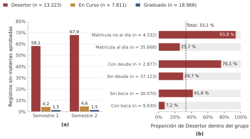
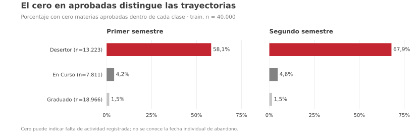
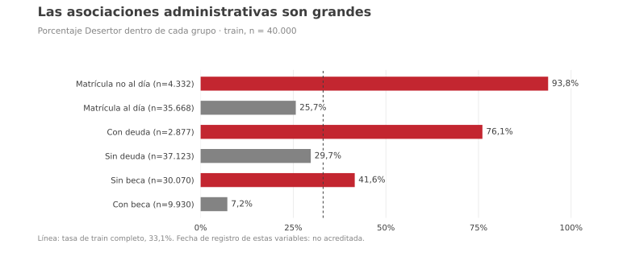
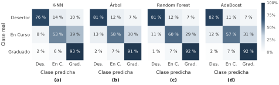
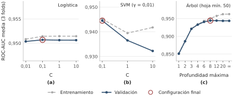
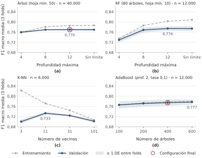
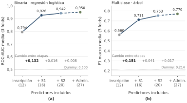
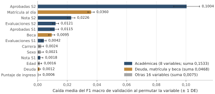
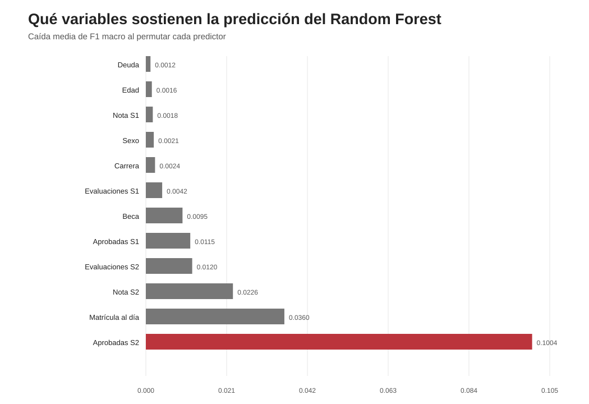

# Predicción de deserción y trayectoria académica en educación superior politécnica

**Trabajo práctico 1 — Aprendizaje Automático, 2026**  
**Integrantes:** [completar]

## Resumen

Comparamos modelos para predecir dos resultados: Desertor frente a No desertor, y los tres estados Desertor, En Curso y Graduado. Analizamos una base sintética transformada de 50.000 registros y 27 predictores. La comparación principal utilizó todas las variables, incluidas las de ambos semestres. La selección de hiperparámetros se hizo por validación cruzada en entrenamiento; como el test había sido observado previamente, su evaluación es exploratoria. En binario, la Regresión Logística obtuvo ROC-AUC 0,9506 y el Soft Voting, 0,9514, sin mejorar F1. En multiclase, Random Forest alcanzó el mayor F1 macro, 0,7808. En Curso fue la clase más difícil y se confundió principalmente con Graduado, un error que la tarea binaria no distingue. En un análisis adicional, incorporamos información de forma acumulativa: inscripción y antecedentes, primer semestre, segundo semestre y variables administrativas y familiares. La mayor mejora apareció al sumar el primer semestre. Los resultados muestran capacidad predictiva en esta base, pero no demuestran que los modelos completos puedan anticipar el abandono desde la inscripción.

## 1. Introducción

La deserción universitaria se relaciona con condiciones personales, administrativas y académicas. Estudiamos si esas variables permiten predecir el estado académico de estudiantes mediante distintos clasificadores. La base utilizada es una versión sintética y transformada de datos cuyo origen es el Instituto Politécnico de Portalegre, Portugal [1,2].

Trabajos sobre esta fuente muestran que la predicción mejora al incorporar el rendimiento del primer año, especialmente del primer semestre [2,3]. Sin embargo, una nota o una cantidad de materias aprobadas puede reflejar dificultades que ya comenzaron. Por eso distinguimos entre predecir usando información del año completo y anticipar el abandono con datos disponibles al inscribirse. El objetivo es comparar modelos y estudiar qué información contribuye a sus predicciones, sin identificar causas de deserción.

A partir de la exploración en entrenamiento planteamos tres hipótesis, que contrastamos mediante los modelos, el análisis por bloques y los errores por clase:

- **H1.** La actividad y el rendimiento académico del primer año aportan la mayor información predictiva.
- **H2.** Las variables administrativas y de ingreso aportan información, pero menos que las académicas.
- **H3.** En Curso tendrá menor sensibilidad y F1 que las otras clases y se confundirá principalmente con Graduado. Agrupar ambas como No desertor ocultará ese tipo de error.

## 2. Materiales y métodos

### 2.1. Datos y variables explicativas

El archivo `dataset_TP1_2026.csv` contiene **50.000 registros, 27 predictores y una respuesta**, con nombres y categorías en castellano. El generador disponible para este TP [7] toma como entrada el `train.csv` de Kaggle Playground Series S4E6 [4], derivado sintéticamente del conjunto de UCI *Predict Students’ Dropout and Academic Success* [2]. Documenta traducciones, agrupamientos, reescalados y un muestreo por respuesta y carrera con objetivo predeterminado de 50.000 filas. El análisis del TP parte del CSV ya preparado; no aplica nuevamente esas transformaciones.

Los predictores son 11 numéricos y 16 categóricos. Para describirlos y compararlos se organizaron en cuatro grupos (Figura 1):

- **Inscripción y antecedentes: 12 variables**, como edad al inscribirse, carrera y estudios previos.
- **Primer semestre (S1): cuatro variables**, correspondientes a materias inscriptas, evaluaciones, materias aprobadas y nota promedio.
- **Segundo semestre (S2): cuatro variables**, con las mismas medidas para ese período.
- **Administrativas y familiares: siete variables**, correspondientes a deuda, matrícula al día, beca y cuatro derivadas de ocupaciones parentales. No se conoce cuándo se registraron o actualizaron. Los rótulos de ingresos y demanda cognitiva son recodificaciones de ocupación, no mediciones directas de esas características.

**Figura 1.** La comparación principal usa los 27 predictores. El análisis adicional comienza con 12 y agrega grupos hasta llegar a 27; el último grupo no representa un momento posterior al segundo semestre.

El análisis exploratorio (EDA) se realizó sobre 40.000 registros de entrenamiento, obtenidos mediante una partición 80/20 estratificada por las tres clases, con semilla 42. Allí hubo 18.966 Graduado (47,42 %), 13.223 Desertor (33,06 %) y 7.811 En Curso (19,53 %). No se aplicaron remuestreo ni pesos de clase; el desbalance se tuvo en cuenta mediante F1 macro y métricas por clase.

No había faltantes explícitos. Se conservaron 213 repeticiones de filas completas y 235 repeticiones de perfiles de predictores; 22 perfiles tenían etiquetas diferentes. También se conservaron 34 casos de S1 y 62 de S2 con más materias aprobadas que inscriptas, porque no había información suficiente para corregirlos. Dos pares de variables parentales eran recodificaciones equivalentes. Los ceros académicos se analizaron por separado, sin tratarlos como faltantes.

Una exploración previa había observado las etiquetas de toda la base. Por eso, aunque la selección posterior se hizo en entrenamiento, **los resultados de test son exploratorios y no una confirmación independiente**.

### 2.2. Tareas objetivo y particiones

En la clasificación binaria, **Desertor = 1** y **En Curso + Graduado = 0 (No desertor)**. En multiclase se conservaron las tres etiquetas. En Curso describe el estado observado: no sabemos si esos estudiantes se graduarán o abandonarán después.

Cada tarea utilizó una partición 80/20 con semilla 42, estratificada por su propia respuesta: 40.000 registros para entrenamiento y 10.000 para prueba (test). Los test de ambas tareas contienen filas diferentes; por eso no se comparan directamente sus puntajes como si midieran la misma tarea.

### 2.3. Preparación, modelos y evaluación

**La comparación principal se hizo con los 27 predictores, incluida la información de ambos semestres.** El preprocesamiento y el modelo se integraron en un *pipeline*: las transformaciones se ajustaron dentro de cada fold de entrenamiento. Se incluyeron imputadores por mediana y moda, pero no reemplazaron valores porque no había faltantes. One-Hot convirtió los 27 predictores en 77 columnas. Las numéricas se estandarizaron para Logística, SVM y K-NN, sensibles a la escala; no para los árboles. El EDA no se usó para eliminar variables.

Se compararon las familias pedidas en la consigna, con propiedades diferentes:

- **Logística con L2:** transforma una combinación lineal de predictores en una probabilidad. La penalización limita la magnitud de sus coeficientes; menor C significa mayor regularización.
- **SVM RBF:** separa las clases buscando un margen y permite fronteras no lineales. C penaliza las violaciones del margen y γ controla el alcance de la similitud.
- **Árbol:** aprende preguntas por umbrales usando Gini. Captura interacciones, pero puede sobreajustar; profundidad y tamaño mínimo de hoja controlan su flexibilidad.
- **K-NN:** clasifica según los vecinos más próximos. Pocos vecinos producen decisiones más locales; más vecinos las suavizan.
- **Random Forest (bagging):** combina árboles entrenados con muestras bootstrap y subconjuntos aleatorios de variables por división. El promedio busca reducir la varianza [5], sin garantizar ausencia de sobreajuste. Se fijó `max_features="sqrt"`.
- **AdaBoost (boosting):** combina árboles pequeños en secuencia, dando más peso a los casos mal clasificados. Se ajustaron cantidad de árboles, profundidad y tasa de aprendizaje.

Para cada modelo se definió una grilla de hiperparámetros: las opciones iniciales figuran en «Valores probados» de la Tabla 1. Se evaluaron todas sus combinaciones mediante **validación cruzada estratificada de tres folds (particiones)** dentro de entrenamiento; la configuración seleccionada figura en «Elegido». Cada configuración se ajustó con aproximadamente 26.667 casos y se validó con 13.333. Se seleccionó por ROC-AUC en binario y por F1 macro en multiclase; después se reentrenó con las 40.000 filas y se evaluó en test.

**Tabla 1.** Hiperparámetros probados y seleccionados por validación cruzada.

| Tarea · modelo | Valores probados | Elegido |
|---|---|---|
| Binaria · Logística | C: 0,01; 0,1; 1; 10 | C=0,1 |
| Binaria · SVM | C: 0,1; 1; 10 · γ: scale; 0,01; 0,1 | C=0,1; γ=0,01 |
| Binaria · Árbol | profundidad: 2; 4; 6; 8; 12; sin límite · hoja mín.: 1; 10; 50 | prof. 8; hoja 50 |
| 3 clases · K-NN | k: 3; 5; 9; 15; 25 · peso: uniforme, distancia | k=25; uniforme |
| 3 clases · Árbol | profundidad: 2; 4; 6; 8; 12; sin límite · hoja mín.: 1; 10; 50 | prof. 12; hoja 50 |
| 3 clases · Random Forest | árboles: 200; 500 · profundidad: 12, sin límite · hoja mín.: 1; 50 | 500; sin límite; hoja 1 |
| 3 clases · AdaBoost | prof. base: 1; 2 · árboles: 100; 200; 400 · tasa: 0,05; 0,1 | prof. 2; 400; tasa 0,1 |

C es la inversa de la intensidad de regularización; γ es el parámetro del núcleo RBF; k, la cantidad de vecinos; hoja mín., el mínimo de casos por hoja.

Se agregó un **Soft Voting** de Logística, SVM y Árbol binarios, con las configuraciones elegidas y pesos iguales. Se promediaron sus probabilidades. Para obtenerlas del SVM, `CalibratedClassifierCV` calibró el pipeline completo mediante una sigmoide y tres folds internos (`ensemble=False`), reajustando también el preprocesamiento. Estos folds sirven para calibrar, no para elegir hiperparámetros.

Se reportaron accuracy, precisión, sensibilidad (*recall*), F1 y ROC-AUC. La AUC mide el ordenamiento por riesgo a distintos umbrales; F1 combina precisión y sensibilidad. En multiclase, el promedio macro da el mismo peso a cada clase al evaluar, sin cambiar los pesos del entrenamiento. Los modelos multiclase admiten directamente tres etiquetas; no necesitaron clasificadores OvR/OvO. La AUC multiclase se resumió mediante OvR (cada clase frente al resto), distinto del promedio por pares descrito por Hand y Till [6]. Las predicciones probabilísticas usaron la clase más probable y el SVM individual, el signo de su función de decisión.

### 2.4. Análisis adicionales

**Análisis acumulativo.** Para estudiar qué aporta cada grupo, se entrenaron Logística binaria y Árbol multiclase agregando información en este orden:

1. Inscripción y antecedentes: **12 variables**.
2. Las anteriores + primer semestre: **16 variables**.
3. Las anteriores + segundo semestre: **20 variables**.
4. Las anteriores + administrativas y familiares: **27 variables**.

No se analizaron semestres aislados. Se conservaron las mismas filas y particiones de validación dentro de cada tarea y se seleccionaron hiperparámetros en cada etapa. Por eso, la comparación muestra el desempeño alcanzado con cada conjunto de información, no el efecto de agregar variables a una configuración fija. Este análisis usa el split estratificado por tres clases, también para Logística; es distinto del split binario de la comparación principal.

**Complejidad y sensibilidad.** Se comparó entrenamiento con validación al variar un hiperparámetro por vez. Las curvas de RF y AdaBoost usaron 12.000 filas y la de K-NN, 6.000, por costo computacional. Además se compararon tres y cinco folds con modelos fijos, una segunda grilla del Árbol y una referencia Dummy que predice siempre la clase más frecuente. Las ampliaciones de K-NN y AdaBoost se hicieron después de observar test, sin cambiar los modelos finales.

**Importancia de variables.** Se midió cuánto bajaba el F1 macro del bosque al permutar cada predictor original, antes de One-Hot, con cinco repeticiones por columna en cada uno de tres folds de validación. También se evaluó el efecto de excluir del test perfiles idénticos a los de entrenamiento.

## 3. Resultados

### 3.1. Exploración en entrenamiento

Entre los Desertor, el **58,1 %** no tenía materias aprobadas en S1 y el **67,9 %** en S2. En En Curso fueron 4,2 % y 4,6 %, y en Graduado, aproximadamente 1,5 % en ambos semestres (Figura 2a). Entre quienes habían aprobado alguna materia, las medianas fueron 4/5/6 en S1 y 3/4/6 en S2, para Desertor/En Curso/Graduado. Cero materias aprobadas no permite distinguir entre no rendir y rendir sin aprobar.

La deserción fue **93,79 %** entre quienes no tenían la matrícula al día (n=4.332), **76,05 %** con deuda (n=2.877) y **7,21 %** con beca (n=9.930), frente al 33,06 % general (Figura 2b). La mediana de edad fue 22 años en Desertor y 19 en las otras clases. Estas asociaciones no indican causas ni establecen si la situación administrativa precedió al abandono.

*(a) Porcentaje con cero materias aprobadas en cada clase.*

*(b) Porcentaje con etiqueta Desertor dentro de cada grupo administrativo: rojo = Desertor; gris = En Curso o Graduado. Cada barra suma 100 %; n indica el tamaño del grupo.*

**Figura 2.** Asociaciones exploratorias en entrenamiento (n=40.000). Cada porcentaje utiliza como denominador su propio grupo.

### 3.2. Clasificación binaria

La Logística obtuvo el mayor F1, **0,8510**. El Voting alcanzó la mayor AUC, **0,9514**, frente a 0,9506 de Logística, pero tuvo menor sensibilidad y F1 (Tabla 2). La mejora de AUC fue pequeña y no se cuantificó su incertidumbre; no permite afirmar superioridad general del ensamble.

**Tabla 2.** Métricas binarias en test (n=10.000). Precisión, sensibilidad y F1 corresponden a Desertor.

| Modelo | Accuracy | Precisión | Sensibilidad | F1 | ROC-AUC |
|---|---:|---:|---:|---:|---:|
| Logística | 0,9066 | 0,9004 | 0,8067 | 0,8510 | 0,9506 |
| SVM | 0,8979 | 0,9150 | 0,7619 | 0,8315 | 0,9460 |
| Árbol | 0,9057 | 0,9064 | 0,7970 | 0,8482 | 0,9440 |
| Soft Voting | 0,9053 | 0,9080 | 0,7940 | 0,8472 | 0,9514 |

Accuracy es la proporción total de aciertos; precisión, la proporción de desertores entre los señalados; sensibilidad, la proporción detectada entre los desertores reales. AUC evalúa el ordenamiento por riesgo.

### 3.3. Complejidad y generalización

Las curvas comparan el desempeño en entrenamiento y validación al modificar la flexibilidad del modelo. Una mejora en entrenamiento sin mejora en validación indica que aumentar la complejidad deja de aportar capacidad predictiva fuera del ajuste.

En binario (Figura 3), la AUC de Logística cambió poco entre C=0,01 y 10: aproximadamente 0,9504–0,9507. En SVM, aumentar C desde la mejor región probada empeoró la validación. En el Árbol con hoja mínima 50, la AUC llegó a **0,9445 en profundidad 8** y luego se estabilizó, mientras entrenamiento siguió mejorando. Estos resultados respaldan controlar la complejidad; no demuestran que la relación verdadera sea lineal.

**Figura 3.** AUC de entrenamiento (gris) y validación (rojo), media de tres folds sobre las 40.000 filas del entrenamiento binario. Las escalas verticales difieren por panel.

En multiclase (Figura 4), el RF reducido pasó de **0,7294 a 0,7741** de F1 macro entre profundidades 4 y 12; sin límite obtuvo 0,7738. Esta curva corresponde a 80 árboles y hoja mínima 10, no al bosque final. En K-NN, k=3 mostró una brecha amplia: 0,823 en entrenamiento frente a 0,700 en validación. La curva tuvo su máximo entre los valores ensayados en k=11; la grilla final eligió k=25 con otra muestra y otros candidatos, de modo que no son comparaciones equivalentes. AdaBoost mejoró de **0,7656 a 0,7771** entre 100 y 600 árboles, sin caída dentro del rango probado.

**Figura 4.** F1 macro de entrenamiento (gris) y validación (rojo), media de tres folds. Árbol: 40.000 filas; RF y AdaBoost: 12.000; K-NN: 6.000. Se interpreta cada curva dentro de su propio protocolo.

### 3.4. Comprobaciones de referencia y selección

La referencia Dummy obtuvo AUC **0,500** en binario y F1 macro **0,214** en multiclase, por debajo de Logística y Árbol (Figura 5).

Con modelos fijos, pasar de **tres a cinco folds** cambió la AUC de Logística de 0,9503 a 0,9505 y el F1 macro del Árbol de 0,7698 a 0,7690. En RF reducido (80 árboles, profundidad 12 y hoja mínima 10), de 0,7741 a 0,7726. Los cambios de media fueron pequeños, pero no demuestran que repetir todas las grillas con cinco folds elegiría los mismos parámetros. Esta comprobación usa el split de tres clases; por eso la AUC de Logística difiere ligeramente de la curva binaria.

**Figura 5.** Desempeño de Dummy y modelos fijos con tres folds (gris) y cinco (rojo), dentro de entrenamiento. Los dos paneles usan métricas diferentes.

En la segunda grilla del Árbol, profundidad 12 y hoja 50 obtuvo F1 macro 0,7698, frente a 0,7694 con profundidad 8 y la misma hoja. Sin límite y con hoja 10, entrenamiento llegó a 0,8250, pero validación cayó a 0,7446: un patrón de sobreajuste.

Al ampliar los extremos de la grilla (Tabla 3), K-NN no mejoró más allá de 25 vecinos y AdaBoost siguió mejorando hasta 600 árboles. Se conservaron los modelos finales originales; el mejor valor ensayado no equivale a un óptimo general.

**Tabla 3.** Ampliación de grillas: F1 macro medio en validación de tres folds, con 40.000 filas de entrenamiento.

| Modelo | Configuración fija | Hiperparámetro | Valor | F1 macro |
|---|---|---|---:|---:|
| K-NN | pesos uniformes | *k* (n.º de vecinos) | 25 | **0,7487** |
| | | | 35 | 0,7475 |
| | | | 51 | 0,7453 |
| AdaBoost | profundidad 2; tasa 0,1 | n.º de árboles | 200 | 0,7623 |
| | | | 400 | 0,7715 |
| | | | 600 | **0,7747** |

La negrita indica el mayor F1 macro entre los valores probados para cada modelo.

### 3.5. Clasificación multiclase

Random Forest obtuvo el mayor F1 macro, **0,7808**, seguido por AdaBoost, **0,7776** (Tabla 4). Son los mayores valores observados, sin una prueba de superioridad estadística entre modelos.

**Tabla 4.** Métricas multiclase en test (n=10.000). Los promedios macro dan igual peso a las tres clases.

| Modelo | Accuracy | Precisión macro | Sensibilidad macro | F1 macro | ROC-AUC OvR |
|---|---:|---:|---:|---:|---:|
| K-NN | 0,7943 | 0,7664 | 0,7388 | 0,7483 | 0,9034 |
| Árbol | 0,8106 | 0,7774 | 0,7647 | 0,7699 | 0,9170 |
| Random Forest | 0,8196 | 0,7896 | 0,7750 | 0,7808 | 0,9254 |
| AdaBoost | 0,8182 | 0,7874 | 0,7707 | 0,7776 | 0,9219 |

En Curso tuvo el menor F1 en los cuatro modelos: 0,5542 en K-NN, 0,5899 en Árbol, 0,6096 en RF y 0,6006 en AdaBoost. En RF, su sensibilidad fue 0,5981, frente a 0,8076 para Desertor y 0,9192 para Graduado.

La matriz de RF (Figura 6) respalda H3: de **1.953 casos En Curso**, 569 (29,1 %) se clasificaron como Graduado y 216 (11,1 %) como Desertor. El primer error desaparece al agrupar En Curso y Graduado como No desertor. Esta observación se refiere a las etiquetas; no atribuye al bosque el desempeño de un modelo binario entrenado por separado.

**Figura 6.** Predicciones de RF frente a las clases reales del test. Cada fila muestra porcentajes y conteos de una clase real; los errores aparecen en rojo.

### 3.6. Qué cambia al agregar información

El análisis adicional fue **acumulativo**, no una comparación de semestres aislados (Figura 7). Al pasar de 12 variables de inscripción y antecedentes a esas mismas variables más S1, la AUC de Logística subió de **0,7941 a 0,9262**. Al agregar S2 llegó a **0,9422** y, con las siete administrativas y familiares, a **0,9503**.

En el Árbol multiclase, los F1 macro fueron **0,5603 → 0,7115 → 0,7529 → 0,7698**, respectivamente. La mayor mejora se observó al sumar S1. El último paso completa las 27 variables, pero no corresponde a una fecha conocida de predicción porque no se conoce cuándo se actualizaron los datos administrativos y familiares.

**Figura 7.** Validación cruzada del análisis acumulativo: 12 → 16 → 20 → 27 predictores. Se mantienen las filas y folds dentro de cada tarea, con hiperparámetros seleccionados en cada etapa. El punto rojo agrega las siete variables administrativas y familiares.

### 3.7. Perfiles repetidos entre entrenamiento y test

En el análisis por bloques, 103 registros de test tenían exactamente los mismos 27 predictores que alguna fila de entrenamiento; en 94 coincidía también la etiqueta. Se recalcularon las métricas excluyéndolos, sin reentrenar los modelos (Tabla 5).

**Tabla 5.** Métricas de los modelos del análisis por bloques con y sin perfiles repetidos.

| Modelo | Métrica | Test completo (n=10.000) | Sin repetidos (n=9.897) |
|---|---|---:|---:|
| Logística binaria, 20 variables | ROC-AUC | 0,9446 | 0,9440 |
| Árbol multiclase, 20 variables | F1 macro | 0,7455 | 0,7448 |
| Logística binaria, 27 variables | ROC-AUC | 0,9518 | 0,9513 |
| Árbol multiclase, 27 variables | F1 macro | 0,7699 | 0,7694 |

Las diferencias fueron de 0,0005 a 0,0007. Esto muestra un efecto pequeño de excluir esas coincidencias exactas; no descarta sesgo por perfiles similares ni corrige la exposición previa del test. La AUC 0,9518 corresponde al split del análisis por bloques, distinto del usado en la Tabla 2.

### 3.8. Importancia de variables

En la importancia por permutación de RF, las mayores caídas de F1 macro fueron **materias aprobadas en S2 (0,1004)** y **matrícula al día (0,0360)** (Figura 8). Las sumas descriptivas por grupo fueron 0,1533 para las ocho académicas, 0,0468 para deuda, matrícula y beca, y 0,0075 para las otras 16.

**Figura 8.** Caída media del F1 macro en validación al mezclar los valores de cada predictor original. Un valor mayor indica mayor dependencia del modelo de esa variable.

Estas sumas no descomponen el desempeño ni equivalen a permutar grupos completos. Las variables correlacionadas pueden sustituirse y ocultar parte de su importancia individual. La importancia describe uso predictivo, no efectos causales.

## 4. Discusión

H1 recibió respaldo exploratorio: el rendimiento académico se asoció con la respuesta en el EDA, el mayor aumento de desempeño apareció al agregar S1 y las variables académicas dominaron la importancia por permutación. Esto coincide con trabajos sobre la fuente original [2,3]. H2 recibió respaldo parcial: matrícula al día fue el segundo predictor más importante, pero su fecha desconocida impide establecer si antecedía al abandono. Para H3, En Curso tuvo el menor F1 en todos los modelos y se confundió principalmente con Graduado. Las tres vías de análisis utilizan la misma base y no son confirmaciones independientes.

La Logística fue competitiva en binario; la mayor flexibilidad de SVM y Árbol no produjo una mejora clara. En multiclase, los ensambles de árboles obtuvieron los mayores F1 macro. Estos resultados son compatibles con distintas formas de controlar complejidad y varianza [5], pero no prueban que la relación verdadera sea lineal ni que un algoritmo sea universalmente superior. Para una aplicación de apoyo estudiantil también habría que definir el costo de falsas alarmas y abandonos no detectados, y elegir el umbral en validación.

Las principales limitaciones son el test previamente observado, el origen sintético de la base, los perfiles repetidos y las inconsistencias conservadas. En Curso tampoco es un desenlace definitivo. Las configuraciones elegidas son las mejores entre las ensayadas: algunas grillas terminaron en sus extremos y AdaBoost aún mejoró al ampliarla. Finalmente, usar notas de ambos semestres puede reconocer dificultades ya presentes; no demuestra anticipación desde la inscripción. Una aplicación temprana requiere conocer las fechas de los datos y validarse en otra cohorte.

## 5. Conclusión

Con los 27 predictores, incluida la información de ambos semestres, Logística distinguió Desertor de No desertor con ROC-AUC 0,9506 y RF clasificó los tres estados con F1 macro 0,7808. En Curso fue la clase más difícil y su confusión con Graduado quedó oculta en la tarea binaria. El análisis acumulativo mostró la mayor mejora al agregar el primer semestre. Estos resultados respaldan capacidad predictiva exploratoria en esta base; su uso como alerta temprana requiere una evaluación independiente con información disponible antes del abandono.

## Bibliografía

1. Direção-Geral do Ensino Superior (DGES). *Sistema de Ensino Superior Português*. Ministério da Educação, Ciência e Inovação, Portugal. https://www.dges.gov.pt/pt/pagina/sistema-de-ensino-superior-portugues
2. Realinho V, Machado J, Baptista L, Martins MV. *Predicting Student Dropout and Academic Success*. Data. 2022;7(11):146. doi:10.3390/data7110146.
3. Martins MV, Baptista L, Machado J, Realinho V. *Multi-Class Phased Prediction of Academic Performance and Dropout in Higher Education*. Applied Sciences. 2023;13(8):4702. doi:10.3390/app13084702.
4. Reade W, Chow A. *Classification with an Academic Success Dataset*. Playground Series, Season 4, Episode 6. Kaggle; 2024. https://www.kaggle.com/competitions/playground-series-s4e6
5. Hastie T, Tibshirani R, Friedman J. *The Elements of Statistical Learning*. 2.ª ed. Springer; 2009. Cap. 15.
6. Hand DJ, Till RJ. *A Simple Generalisation of the Area Under the ROC Curve for Multiple Class Classification Problems*. Machine Learning. 2001;45:171–186.
7. *generar_dataset_tp1.py*. Script de preparación disponible para este TP, sin autoría ni fecha consignadas. [Código fuente](../00_base_de_datos/generar_dataset_tp1.py).
